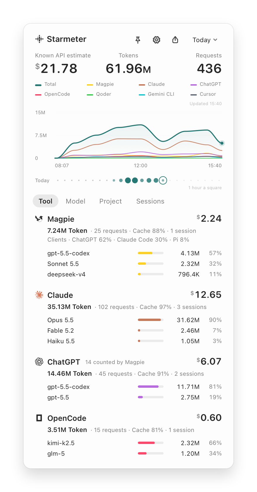
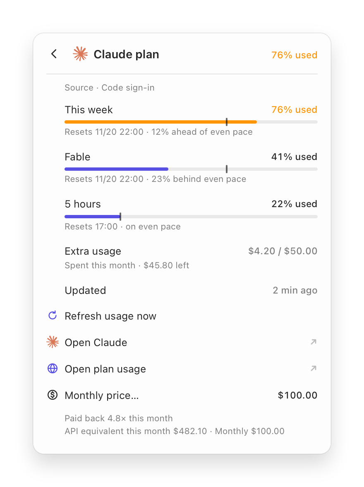
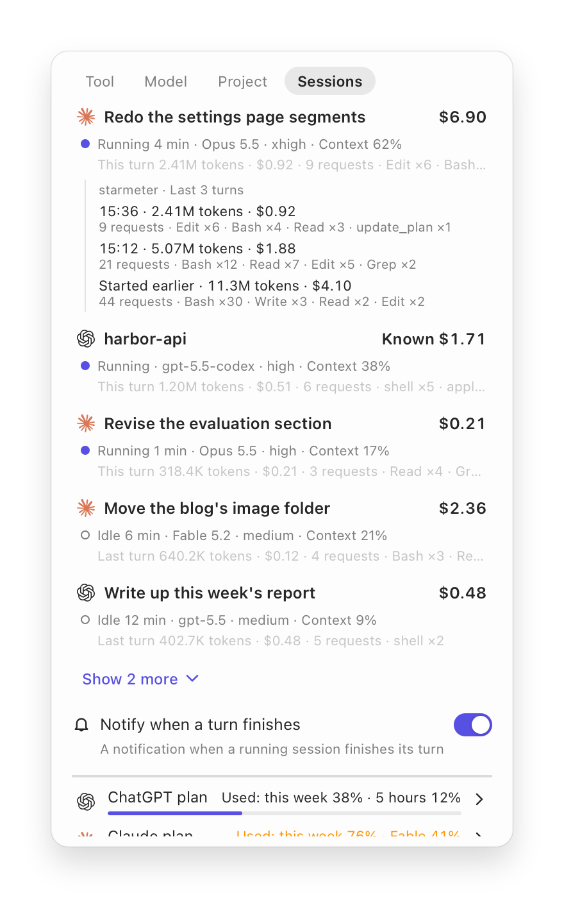
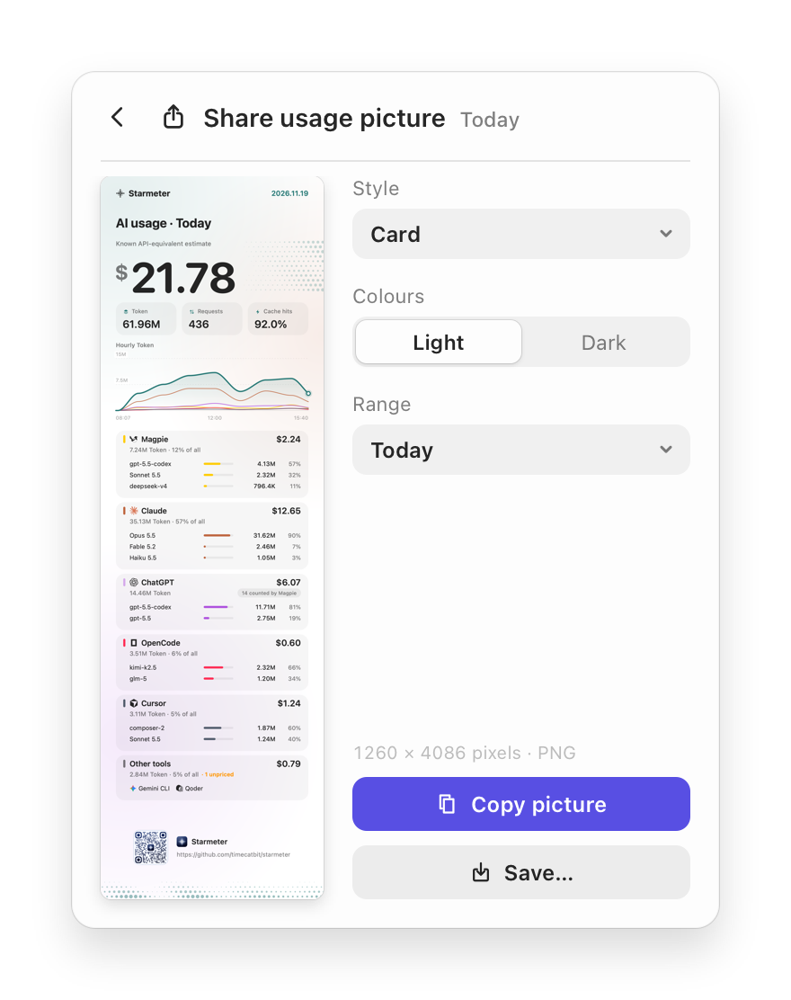

<p align="center"></p>

<h1 align="center">Starmeter</h1>

<p align="center"><b>See how much your AI coding tools use, from the menu bar.</b><br>
Each tool's tokens and API-equivalent cost, subscription limits, API balances and running sessions, in one panel behind a star.</p>

<p align="center"><a href="README.md">简体中文</a> · <b>English</b> · <a href="https://timecatbit.github.io/starmeter/">Website</a> · <a href="#download-and-install">Download and install</a></p>

> [!IMPORTANT]
> **On a Mac, start with the SwiftBar plugin for now.**
> I haven't joined the Apple Developer Program yet, so the standalone DMG isn't signed or notarized by Apple: macOS blocks it the first time, you have to allow it in System Settings → Privacy & Security, and an update may need that again. The SwiftBar plugin runs the same panel and counts the same way without that step, so it's the recommended way for now ([how to install](#download-and-install)). Once I've joined and the DMG is notarized, this note will say so, and you can switch then.

<p align="center">
  <picture><source media="(prefers-color-scheme: dark)" srcset="docs/images/en/home-dark.png"></picture>
  <picture><source media="(prefers-color-scheme: dark)" srcset="docs/images/en/subscription-dark.png"></picture>
  <picture><source media="(prefers-color-scheme: dark)" srcset="docs/images/en/live-dark.png"></picture>
</p>

Starmeter is a star in the macOS menu bar (a standalone app or a SwiftBar plugin) and the Windows tray. It reads only the usage records already on your computer and the official APIs you turn on: no account, no relay server in between. Free and open source. The panel is in Chinese or English: switch under the gear → General → Language.

Formerly Token Monitor. Installed copies keep receiving updates, with their settings and keys.

## What it shows

- **Tool token usage**: Claude (the desktop app and Claude Code in VS Code, JetBrains and the terminal), ChatGPT (Codex), OpenCodex, Magpie, OpenCode, DeepSeek Harness, WorkBuddy, Qoder (the China edition, Qoder CN), Gemini CLI and Cursor (desktop and CLI). Tokens, requests, cache hits, models, a trend chart and a usage heatmap, with the API-equivalent cost estimated at each model's official price. Ranges: today, yesterday, the last 24 hours, 7 or 30 days, this week, this month or everything; the cards, most used first, can be grouped by tool, by model or by project (the project folder a session belongs to). A gateway (Magpie, OpenCodex) and the clients behind it each log the same request; Summary counts it once. Usage that a tool cleans up itself (Claude Code keeps 30 days by default) keeps counting; this can be turned off. On Windows, Claude Code and Codex inside running WSL distributions count too.
- **Subscription limits**: ChatGPT, Claude, MiniMax and Cursor show the share used and when it resets, orange from 70% and red from 90%, and whether you are ahead of or behind an even pace. Qoder reads the Credits the Qoder CN app records locally. Gemini, Grok and Kimi can be marked by hand. With a monthly price entered, the detail page shows how many times over this month's usage has paid for the plan (at API prices).
- **API balances and spend**: DeepSeek, Kimi and Grok balances; Qoder's organisation Credits (team and enterprise plans); Claude's spend this month (needs an admin key); key checks for ChatGPT and Gemini. Each API can hold several keys; the home page shows the total and how many keys, like "Balance ¥12.00 (3)".
- **Sessions**: a fourth choice beside tool, model and project, listing the Claude Code and Codex sessions of the last day, the running and most recently active first: five, and the rest behind "Show more". Each session is a card: what the whole session has cost (live while pinned), whether it is running, this turn's tokens and how much of its context is used; open one for the tokens, cost and tools of its last few turns. Optionally a notification when a turn finishes.
- **Pin it and watch live**: the pin beside the heading keeps the panel above other windows, movable and resizable, turns the trend into a live chart of the last minute (the running total, or output tokens a second) with the running sessions under it, re-read from the local logs every 1–5 seconds.
- **Share pictures**: ten styles (card, terminal, sketch, paper, night sky, metro, knit, receipt, blueprint and neon), each in light and dark, previewed first, then copied or saved (or shared, on a Mac). They hold only what Summary counts: no subscriptions, balances or keys.
- **Combine computers**: choose the same synced folder (iCloud Drive, Dropbox, OneDrive…) under the gear → Data → Combine computers on each computer. Each writes its own usage there, and the home page, the menu bar figure and exports add them up, with "N computers" above the chart. No server in between; the files hold only tools, models and counts.
- **View on your phone**: Phone view, in the gear's grid, shows a QR code; scan it to see the home page in your phone's browser (read-only; change the range, group the cards by tool, model or project, see the sessions, open a tool's page, or make a share picture to save or send). On the same network the phone talks to the computer directly; for a phone elsewhere, choose "Any network" and, once you confirm, Cloudflare makes a temporary public link (cloudflared is downloaded the first time), closed after an hour. On the same network the view stays until you stop it or quit the app.
- **Alerts**: a notification when a subscription window reaches 90% (or 70%, 80%, or never), when a balance drops below your line, and optionally when a weekly window is about to reset barely used.
- **Tool updates**: new versions of the selected clients; Claude Code and Codex CLI update in a terminal with one click.
- **More**: an optional figure beside the menu bar star (today's estimate or the tightest subscription window); a global shortcut (⌃⌥S, say, or Ctrl+Alt+S on Windows) that opens and closes the panel from anywhere; CSV and JSON export of the range on screen; official status pages of Claude, OpenAI and Cursor marked on the cards; estimates in yuan; Komari server monitoring; light, dark or following the system; Chinese or English.

<p align="center">
  <picture><source media="(prefers-color-scheme: dark)" srcset="docs/images/en/models-dark.png"></picture>
  <picture><source media="(prefers-color-scheme: dark)" srcset="docs/images/en/sessions-dark.png"></picture>
  <picture><source media="(prefers-color-scheme: dark)" srcset="docs/images/en/share-page-dark.png"></picture>
</p>

<p align="center"><sub>All screenshots are made from test data, not real usage. More of them, and all ten share pictures, are on the <a href="https://timecatbit.github.io/starmeter/">website</a>.</sub></p>

## Download and install

Download one file from the [latest release](https://github.com/timecatbit/starmeter/releases/latest). The release page lists the names in the second column; the file names are in the third (X.Y.Z is the version).

| Your computer | Name on the release page | File name |
| --- | --- | --- |
| Mac with Apple silicon (not notarized) | **Mac · Apple Silicon** | `starmeter-X.Y.Z-macos-apple-silicon.dmg` |
| Mac with an Intel processor (not notarized) | **Mac · Intel** | `starmeter-X.Y.Z-macos-intel.dmg` |
| Windows 10/11 (recommended) | **Windows · Installer** | `starmeter-X.Y.Z-windows-x64-setup.exe` |
| Windows 10/11, without installing | **Windows · Portable** | `starmeter-X.Y.Z-windows-x64.zip` |
| Mac, recommended for now (needs SwiftBar) | **Mac · SwiftBar plugin** | `starmeter-X.Y.Z.zip`, any chip |

Not sure which Mac you have? Apple menu → **About This Mac**: "Chip: Apple M…" means Apple Silicon, "Processor: Intel…" means Intel. The `sha256:` beside each file is GitHub's checksum, to compare with your download if you like.

### Mac: standalone app or SwiftBar plugin?

Both run the same panel and the same compiled usage engine on macOS 13 or later, and count exactly the same way.

| | Standalone DMG | SwiftBar plugin |
| --- | --- | --- |
| Pros | Drag into Applications; no SwiftBar needed; start at login from the star's right-click menu | For people who already manage plugins with SwiftBar; smaller; updates itself from the panel |
| Trade-offs | The preview isn't notarized, so the first launch may need allowing by hand; new versions replace the app from a new DMG | Needs SwiftBar; installing runs one `python3` script in Terminal, though the plugin itself needs no Python |
| For | A standalone app without SwiftBar | SwiftBar users who want to keep managing plugins there |

**Standalone app**: open the disk image, drag **Starmeter** to **Applications**, eject, and open it from Applications. The preview is **not notarized**: if macOS blocks it, make sure it came from this project's release page, then use System Settings → Privacy & Security → Open Anyway. Managed Macs may not allow this. Both versions share the same settings and keys; when switching from the plugin, disable it in SwiftBar first so you don't get two stars and duplicate alerts.

**Standalone app with Homebrew**: picks the right DMG for your chip.

```sh
brew install --cask timecatbit/tap/starmeter
```

**SwiftBar plugin**: install [SwiftBar](https://github.com/swiftbar/SwiftBar/releases/latest) (or `brew install --cask swiftbar`) and choose its plugin folder. Then unpack **Mac · SwiftBar plugin** and run, in the unpacked folder:

```sh
python3 install.py
```

The installer finds the SwiftBar plugin folder and keeps your settings and a backup; the star appears in the menu bar and the download can go. From a source checkout, run `python3 scripts/install.py` (needs Rust, Node.js and the Xcode command line tools).

### Windows

**Installer**: run `…-windows-x64-setup.exe`. It installs for the current user only, without administrator rights; on older Windows 10 without the WebView2 runtime it installs that first. A desktop shortcut and starting at login are options during setup. The star then sits in the tray at the bottom right of the taskbar; click it to open the panel. Uninstalling keeps your settings and keys.

**Portable**: unpack `…-windows-x64.zip` and run `Starmeter.exe` inside.

Settings live in `%LOCALAPPDATA%\Token Monitor`.

## Updates

- **SwiftBar plugin**: when a new version is out, a **Starmeter · 可更新** row appears under 工具更新 (tool updates). Confirm the update and the plugin downloads, verifies and installs it, keeping settings, keys and statistics. The row isn't there when there's nothing new.
- **Standalone app**: when there's a new version for your chip, the panel links to the release page; quit the app and replace it with the new disk image for the same chip. With Homebrew, run `brew upgrade --cask starmeter`.
- **Price tables** update daily on their own, so new models don't wait for a release.

## Using it

- **Click the star** for the home page, showing today. On first run it reads the usage records already on this computer in the background; choose 全部 (everything) to see all that's still kept locally, without making new calls. Conversations that were deleted, never synced here or logged no tokens can't be counted.
- The first time it opens, the panel walks you through its homepage: the welcome screen lets you pick English straight away, then it lights up the overview, the range, the cards, the plan and API rows and the header's buttons in turn. With no tool found on this computer yet, it shows where to choose your tools or auto-detect them instead; while the first reading is still under way, it says the figures will appear by themselves. Replay it from the gear → General → Quick tour.
- Beside the heading are the pin, the gear (modules and settings), share and the range. A row with an arrow opens its page; the back button, Esc or a two-finger swipe right return home.
- **Right-click the star → 主页模块…** (home modules) to choose what the home page shows and set folders, keys and connections; **自动检测…** (detect) re-selects modules from the tools installed here, and changes nothing until you confirm.
- **Gateways**: Magpie is read from its local `usage.jsonl` (`~/.config/magpie` by default), OpenCodex from its own log. With both a gateway and a client behind it selected (ChatGPT or Claude, say), the requests that went through the gateway count once in Summary, under the gateway; the client's card still shows all its own records and notes "N 次已由 Magpie 计入" (N counted by Magpie). The ChatGPT desktop app's extra calls (message predictions and the like) never reach the local Codex records, so they're only counted through Magpie, which is why Magpie may show more ChatGPT requests than the ChatGPT card.
- **DeepSeek Harness** reads `~/.dsh/sessions` by default (the `sessions` folder under `DSH_HOME` when set), or a folder you choose.
- Advanced settings on a Mac go in `~/Library/Application Support/SwiftBarToken/config.local.sh`; see [config.example.sh](config.example.sh) for the variables. If a command line tool is only on PATH once a terminal has set it up (installed through nvm, say), add its `bin` folder to PATH in that file.

## Privacy

- Local logs are only read. Only usage counters are kept, and of a project only its folder name; never prompts or replies.
- Keys stay on this computer in files only you can read, and are never shown.
- Claude subscription usage is read only once you turn it on, with the local Claude Code sign-in, from Anthropic's usage endpoint; the token stays in memory and is never refreshed or written back.
- Cursor usage is off by default. Turned on, it reads the Cursor sign-in already saved here; the token stays in memory, goes only to cursor.com for this account's usage records, and is never saved, refreshed or changed.
- Requests go only to the official APIs of the services you turn on. The price tables and the plugin's own updates are checked daily on GitHub with no cookies or identifiers; `export OCX_PRICING_UPDATES=0` or `export OCX_SELF_UPDATES=0` in `config.local.sh` turns them off. Service status pages and the yuan exchange rate are read only when you turn them on.
- Combining computers writes only to the synced folder you choose and leaves the syncing to your cloud drive: no Starmeter server. The files hold only computer names, tools, models and counts; no paths, projects, conversations or keys.
- Viewing on your phone, the figures go straight from this computer to the phone over your local network, and the link carries a one-time key without which nothing opens. Only "Any network" goes through a temporary Cloudflare link (cloudflared is downloaded from GitHub the first time), closed after an hour; stopping it or quitting the app closes everything.
- Costs are API-equivalent estimates at official prices, not your subscription bill; models without a known price count tokens only, never a made-up zero.

## Development

The Rust engine (`crates/`) does all the counting, the Tauri app (`app/src-tauri`) provides the star, the tray and the window, and the panel's interface is in `app/ui` (Svelte).

```sh
python3 scripts/check.py    # UI checks and build, Rust and Python tests
python3 scripts/install.py  # build and install into SwiftBar
python3 scripts/package.py  # build the release zip
node docs/screenshots.mjs   # retake the screenshots from test data
```

To release, keep the version in the `Cargo.toml` workspace, `app/src-tauri/tauri.conf.json`, `app/package.json` and the entry script's `xbar.version` in step, add the version to the CHANGELOG, then push a `v<version>` tag; GitHub Actions builds and publishes. Conventions are in [AGENTS.md](AGENTS.md) and changes in [CHANGELOG.md](CHANGELOG.md) (both in Chinese).

## License

[MIT](LICENSE) © timecatbit. Brand marks belong to their owners and only identify the services; the icon files' license is in [assets/logos/LICENSE](assets/logos/LICENSE).
