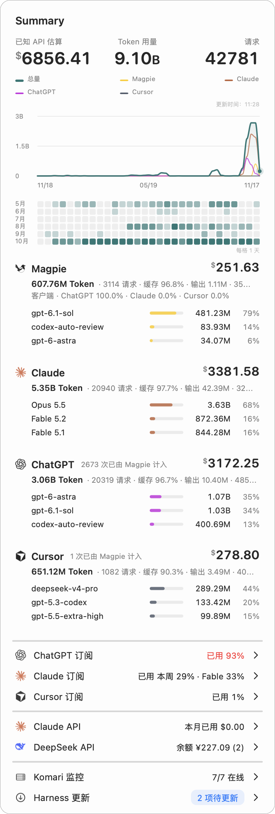

# Starmeter

[简体中文](README.md) · **English**

A macOS menu bar and Windows tray app: one panel for the token usage and API-equivalent cost of your AI coding tools, plus subscription limits, API balances and client updates. The interface is in Chinese.

Formerly Token Monitor. Installed copies keep receiving updates, with their settings and keys.

<p align="center">
  
</p>

## What it shows

- **Harness usage**: Claude (the desktop app and Claude Code in VS Code, JetBrains and the terminal), ChatGPT (Codex), OpenCodex, Magpie, OpenCode, DeepSeek Harness, WorkBuddy, Qoder CN, Gemini CLI and Cursor (desktop and CLI). Tokens, requests, cache hits, models and a trend chart, with the API-equivalent cost estimated at each model's official price. Ranges: today, yesterday, the last 24 hours, 7 or 30 days, this week, this month or everything. The cards can be grouped by tool, by model or by project (the folder a request ran in). Usage that a tool cleans up itself (Claude Code keeps 30 days by default) keeps counting; this can be turned off.
- **Subscriptions**: ChatGPT, Claude, MiniMax and Cursor show the share used and when it resets, orange from 70% and red from 90%, and whether you are ahead of or behind an even pace. Qoder CN reads the Credits the Qoder CN app records locally. Gemini, Grok and Kimi can be marked by hand. With a monthly price entered, ChatGPT, Claude, Cursor and Gemini show how many times over this month's usage has paid for the plan.
- **APIs**: DeepSeek, Kimi and Grok balances; Qoder CN's organisation Credits (team and enterprise plans); Claude's spend this month (needs an admin key); key checks for ChatGPT and Gemini. Each API can hold several keys.
- **Alerts**: a notification when a subscription window reaches 90% (or 70%, 80%, or never), when a balance drops below your line, and optionally when a weekly window is about to reset barely used.
- **Harness updates**: new versions of the selected clients; Claude Code and Codex CLI update in a terminal with one click.
- **More**: Komari server monitoring; a share button that turns the current usage into a picture; an optional figure beside the menu bar star (today's estimate or the tightest subscription window); CSV and JSON export of the range on screen; active Claude Code and Codex sessions with their context use and a turn-by-turn breakdown, optionally notifying when a turn finishes; official service status pages (off by default); estimates in yuan at the daily ECB reference rate; a pin beside the heading keeps the panel on screen and re-reads the local logs every 1–5 seconds.

## Download and install

Download one file from the [latest release](https://github.com/timecatbit/starmeter/releases/latest). The release page lists the names in the second column; the file names are in the third (X.Y.Z is the version).

| Your computer | Name on the release page | File name |
| --- | --- | --- |
| Mac with Apple silicon | **Mac · Apple Silicon** | `token-monitor-X.Y.Z-macos-apple-silicon.dmg` |
| Mac with an Intel processor | **Mac · Intel** | `token-monitor-X.Y.Z-macos-intel.dmg` |
| Windows 10/11 (recommended) | **Windows · Installer** | `token-monitor-X.Y.Z-windows-x64-setup.exe` |
| Windows 10/11, without installing | **Windows · Portable** | `token-monitor-X.Y.Z-windows-x64.zip` |
| Mac already using SwiftBar | **Mac · SwiftBar plugin** | `token-monitor-X.Y.Z.zip`, any chip |

Not sure which Mac you have? Apple menu → **About This Mac**: "Chip: Apple M…" means Apple Silicon, "Processor: Intel…" means Intel. The `sha256:` beside each file is GitHub's checksum. Windows details are in the [Windows guide](windows/README.md) (Chinese).

**Standalone app (Mac)**: open the disk image, drag **Starmeter** to **Applications**, eject, and open it from Applications. The preview is **not notarized**: if macOS blocks it, make sure it came from this project's release page, then use System Settings → Privacy & Security → Open Anyway. Managed Macs may not allow this.

**SwiftBar plugin (Mac)**: install [SwiftBar](https://github.com/swiftbar/SwiftBar/releases/latest) (or `brew install --cask swiftbar`) and choose its plugin folder. Then unpack **Mac · SwiftBar plugin** and run, in the unpacked folder:

```sh
python3 install.py
```

The installer finds the SwiftBar plugin folder and keeps your settings and a backup. From a source checkout, run `python3 scripts/install.py` (needs the Xcode command line tools).

## Updates

- **SwiftBar plugin**: when a new version is out, a **Starmeter · 可更新** row appears under Harness updates. Confirm the update and the plugin downloads, verifies and installs it, keeping settings, keys and statistics.
- **Standalone app**: the panel links to the release page; quit the app and replace it with the new disk image for your chip.
- **Price tables** update daily on their own.

## Privacy

- Local logs are only read. Only usage counters are kept; never prompts or replies. Of a project, only its folder name.
- Keys stay on this computer in files only you can read, and are never shown.
- Cursor usage is read only after you turn it on; its token stays in memory and goes only to cursor.com.
- Requests go only to the services you enable. The price tables and the plugin's own updates are checked daily on GitHub with no cookies or identifiers (`OCX_PRICING_UPDATES=0` and `OCX_SELF_UPDATES=0` turn them off). Service status pages and the exchange rate are read only when you turn them on.
- Costs are API-equivalent estimates at official prices, not your subscription bill; models without a known price count tokens only, never a made-up zero.

## Development

```sh
python3 scripts/check.py    # tests
python3 scripts/install.py  # build the panel and install into SwiftBar
python3 scripts/package.py  # build the release zip
```

To release, keep `VERSION` in `lib/swiftbar_plugin.py`, `xbar.version` in the entry script and the CHANGELOG in step, then push a `v<version>` tag; GitHub Actions builds and publishes. Conventions are in [AGENTS.md](AGENTS.md) and changes in [CHANGELOG.md](CHANGELOG.md) (both in Chinese).

## Thanks

- [SwiftBar](https://github.com/swiftbar/SwiftBar) (MIT): the plugin's menu bar item, menu and schedule.
- [ccusage](https://github.com/ccusage/ccusage) (MIT): usage rules and model price snapshots; see [lib/CCUSAGE_LICENSE](lib/CCUSAGE_LICENSE).
- [models.dev](https://github.com/anomalyco/models.dev) (MIT): prices of new OpenAI models before ccusage has them.
- [CodexBar](https://github.com/steipete/CodexBar) (MIT): reference for reading Claude usage; see [lib/CODEXBAR_LICENSE](lib/CODEXBAR_LICENSE).
- [LobeHub Icons](https://github.com/lobehub/lobe-icons) (MIT): brand icons; see [assets/logos/LICENSE](assets/logos/LICENSE). Marks belong to their owners and only identify the services.

## License

[MIT](LICENSE) © minicoke. Third-party code and icons are used under their own licenses, listed above.
