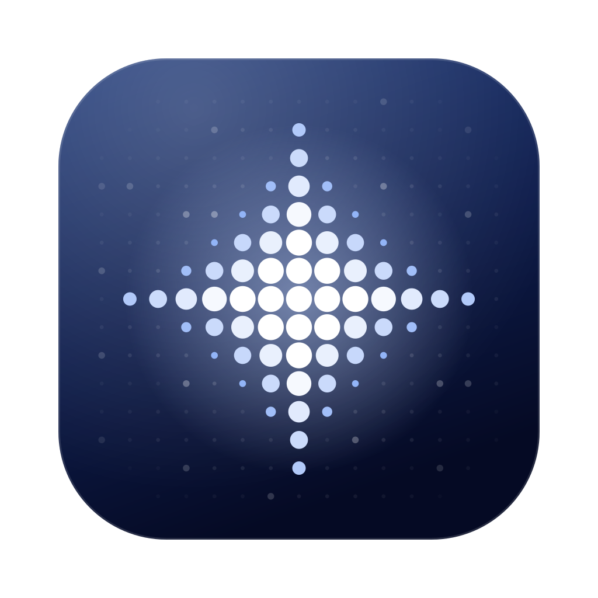
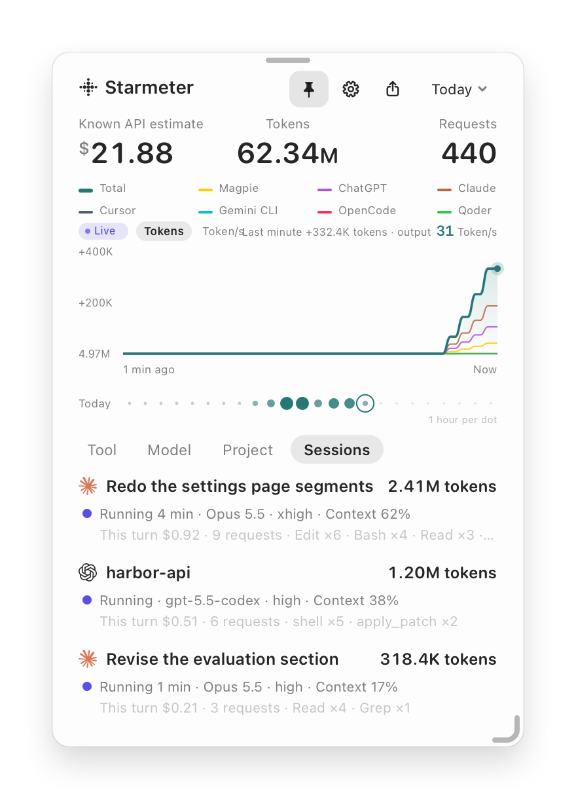
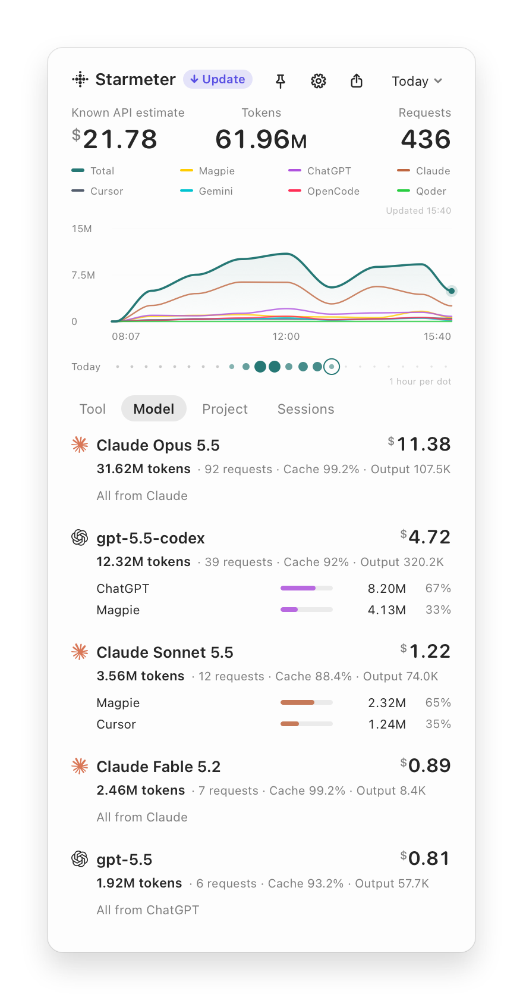

<p align="center"></p>

<h1 align="center">Starmeter</h1>

<p align="center"><b>See how much your AI coding tools use, from the menu bar.</b><br>
Each tool's tokens and API-equivalent cost, subscription limits, API balances and running sessions, in one panel behind a star.</p>

<p align="center"><a href="README.md">简体中文</a> · <a href="README.zh-Hant.md">繁體中文</a> · <b>English</b> · <a href="https://timecatbit.github.io/starmeter/">Website</a> · <a href="#download-and-install">Download and install</a></p>

> [!IMPORTANT]
> **On a Mac, start with the SwiftBar plugin for now.**
> I haven't joined the Apple Developer Program yet, so the standalone DMG isn't signed or notarized by Apple: macOS blocks it the first time, you have to allow it in System Settings → Privacy & Security, and an update may need that again. The SwiftBar plugin runs the same panel and counts the same way without that step, so it's the recommended way for now ([how to install](#download-and-install)). Once I've joined and the DMG is notarized, this note will say so, and you can switch then.

<p align="center">
  <picture><source media="(prefers-color-scheme: dark)" srcset="docs/images/en/home-dark.png"></picture>
  <picture><source media="(prefers-color-scheme: dark)" srcset="docs/images/en/subscription-dark.png"></picture>
  <picture><source media="(prefers-color-scheme: dark)" srcset="docs/images/en/live-dark.png"></picture>
</p>

Starmeter is a star in the macOS menu bar (a standalone app or a SwiftBar plugin) and the Windows or Linux tray, with a `starmeter` command for the terminal too. It reads only the usage records already on your computer and the official APIs you turn on: no account, no relay server in between. Free and open source. The panel is in Simplified Chinese, Traditional Chinese or English: switch under the gear → General → Language.

Formerly Token Monitor; settings and keys carry over. From 6.0.2 the downloads are named `starmeter-…`, and 6.0.1 or earlier doesn't pick up this update on its own: update once by hand as in [Updating from 6.0.1 or earlier](#updating-from-601-or-earlier), and updates come as usual after that.

## What it shows

- **Tool token usage**: Claude (the desktop app and Claude Code in VS Code, JetBrains and the terminal), ChatGPT (Codex), OpenCodex, Magpie, OpenCode, DeepSeek Harness, WorkBuddy, Qoder (the China edition, Qoder CN), Gemini (Gemini CLI and Antigravity) and Cursor (desktop and CLI). Tokens, requests, cache hits, models, a trend chart and a usage heatmap, with the API-equivalent cost estimated at each model's official price. Ranges: today, yesterday, the last 24 hours, 7 or 30 days, this week, this month or everything; the cards, most used first, can be grouped by tool, by model or by project (the project folder a session belongs to). A gateway (Magpie, OpenCodex) and the clients behind it each log the same request; Summary counts it once. Usage that a tool cleans up itself (Claude Code keeps 30 days by default) keeps counting; this can be turned off. On Windows, Claude Code and Codex inside running WSL distributions count too. The Gemini desktop app keeps no token counts on this computer; with it installed, Gemini's card says its use isn't counted.
- **Subscription limits**: ChatGPT, Claude, MiniMax, Cursor and Gemini show the share used and when it resets, orange from 70% and red from 90%, and whether you are ahead of or behind an even pace. On the homepage ChatGPT and Claude draw their 5-hour and weekly windows as two bars side by side, Gemini has a line for its Gemini models and one for Claude and GPT, each ending with its own logos, and the share of the week used sits beside the name (for Gemini, its Gemini models' own week; without a weekly window, the tightest one). Once the windows are used up the homepage shows what is left to spend beside the name, in orange: ChatGPT's Credits, Claude's extra usage, Cursor's on-demand usage, with the share used under the bar, as in "41,521 credits left" over "100% used this week" (this cycle's for Cursor), and a red "100% used" once the reserve is spent too; ChatGPT's free resets are on its detail page. Gemini's comes from the Antigravity app running on this computer, and Qoder reads the Credits the Qoder CN app records locally. Grok and Kimi can be marked by hand. With a monthly price entered, the detail page shows how many times over this month's usage has paid for the plan (at API prices).
- **API balances and spend**: DeepSeek, Kimi and Grok balances; Qoder's organisation Credits (team and enterprise plans); Claude's spend this month (needs an admin key); key checks for ChatGPT and Gemini. Each API can hold several keys; the home page shows the total and how many keys, like "Balance ¥12.00 (3)".
- **Sessions**: a fourth choice beside tool, model and project, listing the sessions active in the range chosen, the running and most recently active first: five, and the rest behind "Show more", with "Show fewer" at the end once open. Every homepage tool that keeps sessions on this computer is listed: Claude Code, Codex, Gemini CLI, Antigravity and the Gemini desktop app, OpenCode, Qoder, WorkBuddy and DeepSeek Harness. The Gemini app keeps only the conversations opened lately in its cache, with no tokens or cost, so those show their turns and whether they are running; Magpie is a gateway and Cursor's usage comes from cursor.com, so neither has sessions. An Antigravity subagent folds into the task that started it, so it counts as one session. Each session is a card: what it cost in the range chosen, counted as the other tabs count (live while pinned), whether it is running, this turn's tokens and how much of its context is used; open one for the whole session's cost and the tokens, cost and tools of its last few turns. Optionally a notification when a turn finishes.
- **Pin it and watch live**: the pin beside the heading keeps the panel above other windows, movable and resizable, turns the trend into a live curve of the last minute, a line for each tool in its own colour (the tokens added, or output tokens a second; on a log scale when the tools are far apart in size), and switches the tabs below to the fifth, **Live**: the running sessions (this turn's time, model and effort, context, this turn's tokens and cost) and **Activity** (each tool's newest tokens, five at first, the rest a click away), re-read from the local logs every 1–5 seconds. Unpinned, the Live tab is there too.
- **Share pictures**: ten styles (card, terminal, sketch, paper, night sky, metro, knit, receipt, blueprint and neon), each in light and dark, previewed first, then copied or saved (or shared, on a Mac). They hold only what Summary counts: no subscriptions, balances or keys.
- **Look and language**: light, dark or following the system, on a solid, frosted or glass background; or drawn by hand (coloured ink on dotted paper by day, chalk on a blackboard by night, laid out the same). The panel speaks Simplified Chinese, Traditional Chinese and English.
- **Combine computers**: choose the same synced folder (iCloud Drive, Dropbox, OneDrive…) under the gear → Data → Combine computers on each computer. Each writes its own usage there, and the home page, the menu bar figure and exports add them up, with "N computers" above the chart. No server in between; the files hold only tools, models and counts.
- **View on your phone**: the phone button in the homepage's header, left of share, opens Phone view, with a QR code once you press **Start**; scan it and your phone's browser opens the web view, a live monitor (read-only): whether the AI is at work right now, its output tokens a second and today's cost, then the live curve, the running sessions and the activity, and the figures below (change the range or the grouping, or make a share picture to save or send). It follows the computer's light or dark look and style, with layouts for portrait, landscape and a computer's browser; opened through an https link, the sun at the top right keeps the screen on. There are two ways, both off to begin with: opening the page or switching between them starts nothing, only **Start** on a way's own page does. On the same network the phone talks to the computer directly, and with this computer on Tailscale that page shows its local and Tailscale QR codes side by side, so a phone on the same tailnet opens it from anywhere without Cloudflare; for a phone elsewhere, "Any network" makes a temporary public link through Cloudflare once started (cloudflared is downloaded the first time, the button then reading **Download and start**), its QR code shown once a phone can open it, a retry offered if it fails or drops, closed after an hour. A green dot after each choice says which is on (and one on the phone button while either is); **Stop** on a page stops only that way, and **Start again** starts it again. A way left on starts again by itself after the app restarts or updates: the same network keeps its port and key, so the phone's old link still opens; any network, within its hour, makes a new link (a new address, so scan again), and after the hour stays off. A way stopped stays off.
- **Alerts**: a notification when a subscription window reaches 90% (or 70%, 80%, or never), when a balance drops below your line, and optionally when a weekly window is about to reset barely used.
- **Tool updates**: a row each for every homepage tool's app and CLI, with the version installed, the newest official one and where it came from (Homebrew, npm or the vendor's installer), those with updates first; a CLI with an update runs its channel's command in a terminal with one click (`brew upgrade --cask codex`, say), and an app opens to update itself. Google's updater keeps the Gemini desktop app current and Qoder's app has no public version source, so those two rows show only the version installed. A small icon beside the Starmeter title, a down arrow in a ring, says something new is out and opens **Tool updates**, shrinking to a dot once you've looked; turn off **Show updates on the homepage** under **Alerts** and only the system notification tells you.
- **More**: an optional figure beside the menu bar star (today's estimate or the tightest subscription window); a global shortcut (⌃⌥S, say, or Ctrl+Alt+S on Windows) that opens and closes the panel from anywhere; CSV and JSON export of the range on screen; official status pages of Claude, OpenAI and Cursor marked on the cards, each open incident and how far it has got listed beneath, a click away from its own page; estimates in yuan; Komari server monitoring; light, dark or following the system; Chinese or English.

<p align="center">
  <picture><source media="(prefers-color-scheme: dark)" srcset="docs/images/en/models-dark.png"></picture>
  <picture><source media="(prefers-color-scheme: dark)" srcset="docs/images/en/sessions-dark.png"></picture>
  <picture><source media="(prefers-color-scheme: dark)" srcset="docs/images/en/share-page-dark.png"></picture>
</p>

<p align="center"><sub>All screenshots are made from test data, not real usage. More of them, and all ten share pictures, are on the <a href="https://timecatbit.github.io/starmeter/">website</a>.</sub></p>

## Download and install

Download one file from the [latest release](https://github.com/timecatbit/starmeter/releases/latest). The release page lists the names in the second column; the file names are in the third (X.Y.Z is the version).

| Your computer | Name on the release page | File name |
| --- | --- | --- |
| Mac with Apple silicon (not notarized) | **Mac · Apple Silicon** | `starmeter-X.Y.Z-macos-apple-silicon.dmg` |
| Mac with an Intel processor (not notarized) | **Mac · Intel** | `starmeter-X.Y.Z-macos-intel.dmg` |
| Windows 10/11 (recommended) | **Windows · Installer** | `starmeter-X.Y.Z-windows-x64-setup.exe` |
| Windows 10/11, without installing | **Windows · Portable** | `starmeter-X.Y.Z-windows-x64.zip` |
| Mac, recommended for now (needs SwiftBar) | **Mac · SwiftBar plugin** | `starmeter-X.Y.Z.zip`, any chip |
| Ubuntu, Debian and the like | **Linux · Debian/Ubuntu** | `starmeter-X.Y.Z-linux-x64.deb` |
| Other Linux distributions | **Linux · AppImage** | `starmeter-X.Y.Z-linux-x64.AppImage` |
| Only the [command line](#command-line), Mac | **Mac · Command line** | `starmeter-X.Y.Z-macos-cli.tar.gz`, any chip |
| Only the [command line](#command-line), Linux | **Linux · Command line** | `starmeter-X.Y.Z-linux-x64-cli.tar.gz` |

Not sure which Mac you have? Apple menu → **About This Mac**: "Chip: Apple M…" means Apple Silicon, "Processor: Intel…" means Intel. The `sha256:` beside each file is GitHub's checksum, to compare with your download if you like.

### Mac: standalone app or SwiftBar plugin?

Both run the same panel and the same compiled usage engine on macOS 13 or later, count exactly the same way and update from the panel.

| | Standalone DMG | SwiftBar plugin |
| --- | --- | --- |
| Pros | Drag into Applications; no SwiftBar needed; start at login from the star's right-click menu | For people who already manage plugins with SwiftBar; smaller |
| Trade-offs | The preview isn't notarized, so the first launch may need allowing by hand | Needs SwiftBar; installing runs one `python3` script in Terminal, though the plugin itself needs no Python |
| For | A standalone app without SwiftBar | SwiftBar users who want to keep managing plugins there |

**Standalone app**: open the disk image, drag **Starmeter** to **Applications**, eject, and open it from Applications. The preview is **not notarized**: if macOS blocks it, make sure it came from this project's release page, then use System Settings → Privacy & Security → Open Anyway. Managed Macs may not allow this. Both versions share the same settings and keys; when switching from the plugin, disable it in SwiftBar first so you don't get two stars and duplicate alerts.

**Standalone app with Homebrew**: picks the right DMG for your chip.

```sh
brew install --cask timecatbit/tap/starmeter
```

**SwiftBar plugin**: install [SwiftBar](https://github.com/swiftbar/SwiftBar/releases/latest) (or `brew install --cask swiftbar`) and choose its plugin folder. Then unpack **Mac · SwiftBar plugin** and run, in the unpacked folder:

```sh
python3 install.py
```

The installer finds the SwiftBar plugin folder and keeps your settings and a backup; the star appears in the menu bar and the download can go. From a source checkout, run `python3 scripts/install.py` (needs Rust, Node.js and the Xcode command line tools).

### Windows

**Installer**: run `…-windows-x64-setup.exe`. It installs for the current user only, without administrator rights; on older Windows 10 without the WebView2 runtime it installs that first. A desktop shortcut and starting at login are options during setup. The star then sits in the tray at the bottom right of the taskbar; click it to open the panel. Uninstalling keeps your settings and keys.

**Portable**: unpack `…-windows-x64.zip` and run `Starmeter.exe` inside.

Settings live in `%LOCALAPPDATA%\Token Monitor`.

### Linux

**Ubuntu, Debian**: in the download folder run `sudo apt install ./starmeter-X.Y.Z-linux-x64.deb`, then open Starmeter from the applications menu.

**Other distributions**: make `…-linux-x64.AppImage` executable (`chmod +x`) and run it.

The star appears in the tray of the top bar or taskbar. A click on a Linux tray only opens the menu: its first item, **Open panel**, opens the panel. GNOME needs tray support (built into Ubuntu; elsewhere, install the AppIndicator extension). Settings live in `~/.local/share/starmeter`.

## Updates

- **SwiftBar plugin**: when a new version is out, a **Starmeter** row saying "X.Y.Z available" appears below **Tool updates** on the homepage, and first inside it. Choose **Update to X.Y.Z…** and confirm, and the plugin downloads, verifies and installs it, keeping settings, keys and statistics. The row isn't there when there's nothing new.
- **Standalone app**: the same **Starmeter** row appears below **Tool updates** and first inside it. For the Mac app, the installed Windows version and the Linux AppImage, choose **Update to X.Y.Z…** and confirm: the app downloads the package for this computer, checks it against the SHA-256 GitHub publishes, then quits, replaces itself and reopens, keeping settings, keys and statistics. For the `.deb` and the portable Windows version, choose **Open the release on GitHub** under it and download the new one; with Homebrew you can also run `brew upgrade --cask starmeter`.
- **Command line**: with Homebrew, run `brew upgrade starmeter-cli`; the command in the `.deb` and the Windows versions updates with the app.
- **Price tables** update daily on their own, so new models don't wait for a release.

### Updating from 6.0.1 or earlier

From 6.0.2 the downloads are named `starmeter-…`. Versions 6.0.1 and earlier look for the old names, so they don't see this release: update once by hand. Settings, keys and statistics carry over.

- **SwiftBar plugin**: download **Mac · SwiftBar plugin** from the release page, unpack it and run `python3 install.py` in its folder.
- **Standalone Mac app**: quit it, download the disk image for your chip and replace the app in Applications. With Homebrew, run `brew upgrade --cask starmeter`.
- **Windows**: quit from the tray and run the new `starmeter-X.Y.Z-windows-x64-setup.exe` over the old one; for the portable version, unpack the new zip in place of the old folder.

## Using it

- **Click the star** for the home page, showing today. On first run it reads the usage records already on this computer in the background; choose **All time** to see all that's still kept locally, without making new calls. Conversations that were deleted, never synced here or logged no tokens can't be counted.
- The first time it opens, the panel walks you through its homepage: the welcome screen lets you pick English or Traditional Chinese straight away, then it lights up the overview, the range, the cards, the plan and API rows and the header's buttons in turn. With no tool found on this computer yet, it shows where to choose your tools or auto-detect them instead; while the first reading is still under way, it says the figures will appear by themselves. Replay it from the gear → General → Quick tour.
- Beside the heading are the pin, the gear (modules and settings), the phone (Phone view), share and the range. A row with an arrow opens its page; the back button, Esc or a two-finger swipe right return home.
- **Right-click the star → Home modules…** to choose what the home page shows and set folders, keys and connections; **Auto-detect…** re-selects modules from the tools installed here, and changes nothing until you confirm. The menu follows the language you pick in the panel. With the SwiftBar plugin the right-click menu is SwiftBar's own and stays in Chinese, with the same two items at the top.
- **Homepage order**: hold a plan, API or other row for a moment and it lifts; drag it within its group and let go to keep the order, or select a row and press ⌥↑ / ⌥↓ (Alt+↑ / Alt+↓ on Windows and Linux). Tool cards still go by usage. gear → General → Homepage order restores the default order.
- **Gateways**: Magpie is read from its local `usage.jsonl` (`~/.config/magpie` by default), OpenCodex from its own log. With both a gateway and a client behind it selected (ChatGPT or Claude, say), the requests that went through the gateway count once in Summary, under the gateway; the client's card still shows all its own records and notes "N counted by Magpie". The ChatGPT desktop app's extra calls (message predictions and the like) never reach the local Codex records, so they're only counted through Magpie, which is why Magpie may show more ChatGPT requests than the ChatGPT card.
- **DeepSeek Harness** reads `~/.dsh/sessions` by default (the `sessions` folder under `DSH_HOME` when set), or a folder you choose.
- Advanced settings on a Mac go in `~/Library/Application Support/SwiftBarToken/config.local.sh`; see [config.example.sh](config.example.sh) for the variables. If a command line tool is only on PATH once a terminal has set it up (installed through nvm, say), add its `bin` folder to PATH in that file.

## Command line

See your usage in a terminal without opening the panel: `starmeter` prints today's Summary, each tool, and your plans and balances. It counts with the panel's own code, settings and caches, so the figures are the same.

```sh
starmeter                      # today's overview: Summary, each tool, plans and balances
starmeter usage 7d             # the last 7 days' usage and trend
starmeter usage -g model -d    # cards per model, each with its breakdown
starmeter quota                # plans and APIs, with when each limit resets
starmeter detect               # find the tools on this computer, add new ones to the homepage
starmeter usage 30d --json     # JSON for scripts
```

**Install**

- **Mac and Linux**: with Homebrew; the app isn't needed.

  ```sh
  brew install timecatbit/tap/starmeter-cli
  ```

- **Ubuntu, Debian**: the `.deb` installs the `starmeter` command.
- **Windows**: the installed and portable versions have `starmeter.cmd` in their `bin` folder. Add that folder to PATH (`%LOCALAPPDATA%\Programs\Starmeter\bin` for the installed version) to type `starmeter` anywhere.
- **By hand**: download **Mac · Command line** or **Linux · Command line** from the release page, unpack it and add the folder with `starmeter` in it to PATH, keeping the `lib` folder beside it. On a Mac, an archive downloaded in a browser isn't notarized and is blocked the first time it runs; Homebrew is the easier way.

**Notes**

- The ranges are the homepage's: `today` (the default), `yesterday`, `24h`, `7d`, `30d`, `week`, `month`, `all`; the groupings `tool` (the default), `model` and `project`. Write them after the command, or use `-r` and `-g`.
- The settings, connections and caches are the Starmeter app's on this computer: the time zone, the currency and rate, and the modules chosen for the homepage all match the panel. A tool that isn't on the homepage doesn't appear.
- With only the command line installed, its first run finds the tools on this computer, as the app's first launch does. For a tool installed later, `starmeter detect` shows what it finds and `--yes` adds the new ones to the homepage, leaving your other choices as they are.
- Plans and API balances refresh over the network only when due, as when the panel opens; `--no-refresh` shows their last figures.
- The language follows the system (Traditional Chinese on a system in Traditional Chinese); `--lang zh|zh-Hant|en` or the `STARMETER_LANG` variable chooses one. Output to a pipe or a file has no colour (`--color always|never` changes that), and a narrow terminal drops the share bar, then the cache and request columns.
- `--json` always has English keys: `summary` (cost, tokens, requests, cache hit rate), `trend`, `tools`, `groups` (cards per model or project) and `quotas` (plans and APIs). Each cost comes as `cost` in the panel's currency and as `costUsd` in dollars.

## Privacy

- Local logs are only read. Only usage counters are kept, and of a project only its folder name; never prompts or replies.
- Keys stay on this computer in files only you can read, and are never shown.
- Claude subscription usage is read only once you turn it on, with the local Claude Code sign-in, from Anthropic's usage endpoint; the token stays in memory and is never refreshed or written back.
- Cursor usage is off by default. Turned on, it reads the Cursor sign-in already saved here (newer Cursor keeps it encrypted in the keychain: turn on **Read the sign-in from the keychain** on the Cursor plan page and allow it when macOS asks); the token stays in memory, goes only to cursor.com for this account's usage records, and is never saved, refreshed or changed.
- Gemini subscription quota is asked only of the Antigravity app running on this computer (127.0.0.1), with the temporary token it notes locally; the token is used for that request alone and never saved.
- Requests go only to the official APIs of the services you turn on. The price tables and the plugin's own updates are checked daily on GitHub with no cookies or identifiers; `export OCX_PRICING_UPDATES=0` or `export OCX_SELF_UPDATES=0` in `config.local.sh` turns them off. When GitHub can't be reached, the check and the download go through public mirrors (ghfast.top and others, or your own in `STARMETER_GITHUB_MIRRORS`), and the package is still checked against the SHA-256 GitHub publishes. Service status pages and the yuan exchange rate are read only when you turn them on.
- Combining computers writes only to the synced folder you choose and leaves the syncing to your cloud drive: no Starmeter server. The files hold only computer names, tools, models and counts; no paths, projects, conversations or keys.
- Viewing on your phone, the figures go straight from this computer to the phone over your local network (or your own tailnet), and the link carries a one-time key without which nothing opens. Only "Any network", once started, goes through a temporary Cloudflare link (cloudflared is downloaded from GitHub the first time), closed after an hour; each way's Stop closes only that way, and quitting the app closes everything.
- Costs are API-equivalent estimates at official prices, not your subscription bill; models without a known price count tokens only, never a made-up zero.

## Development

The Rust engine (`crates/`) does all the counting, the Tauri app (`app/src-tauri`) provides the star, the tray and the window, and the panel's interface is in `app/ui` (Svelte).

```sh
python3 scripts/check.py    # UI checks and build, Rust and Python tests
python3 scripts/install.py  # build and install into SwiftBar
python3 scripts/package.py  # build the release zip
node docs/screenshots.mjs   # retake the screenshots from test data
```

To release, keep the version in the `Cargo.toml` workspace, `app/src-tauri/tauri.conf.json`, `app/package.json` and the entry script's `xbar.version` in step, add the version to the CHANGELOG, then push a `v<version>` tag; GitHub Actions builds and publishes. Conventions are in [AGENTS.md](AGENTS.md) and changes in [CHANGELOG.md](CHANGELOG.md) (both in Chinese).

## Star history

<a href="https://github.com/timecatbit/starmeter/stargazers">
  <picture>
    <source media="(prefers-color-scheme: dark)" srcset="https://raw.githubusercontent.com/timecatbit/starmeter/stars/stars-dark.svg">
    
  </picture>
</a>

## License

[MIT](LICENSE) © timecatbit. Brand marks belong to their owners and only identify the services; the icon files' license is in [assets/logos/LICENSE](assets/logos/LICENSE). The hand-drawn look's Chinese faces, LXGW WenKai and LXGW WenKai TC, are under the SIL Open Font License 1.1; the app bundles web subsets of them, their license texts beside them in [app/ui/public/fonts](app/ui/public/fonts).
