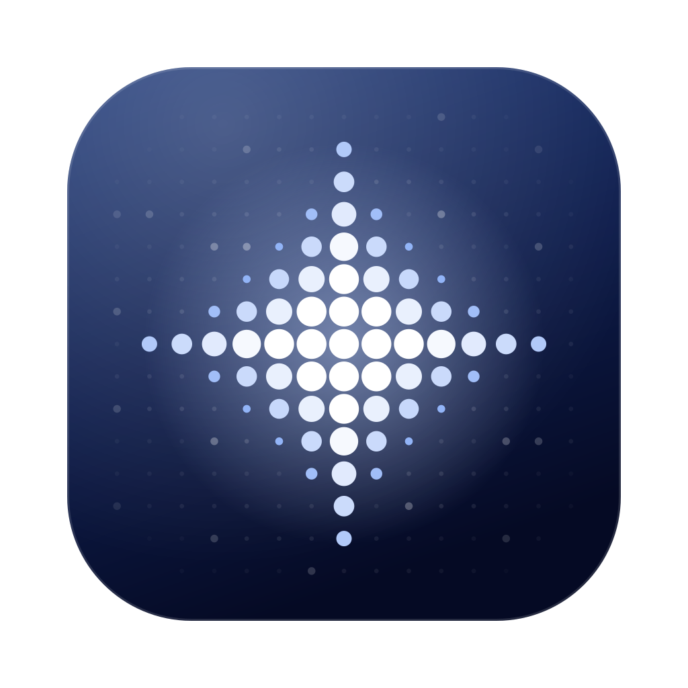
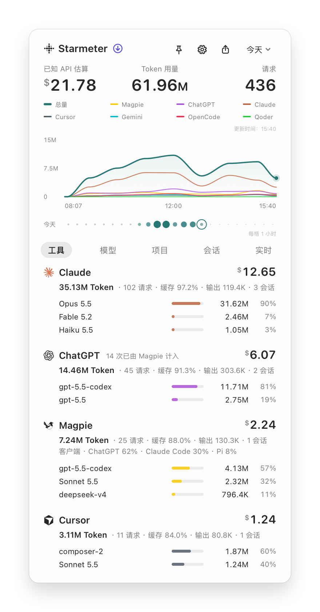
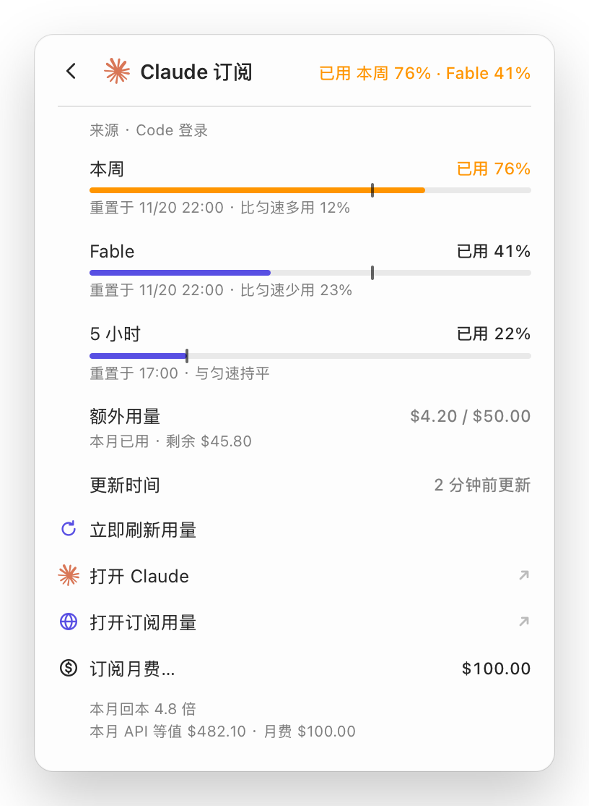
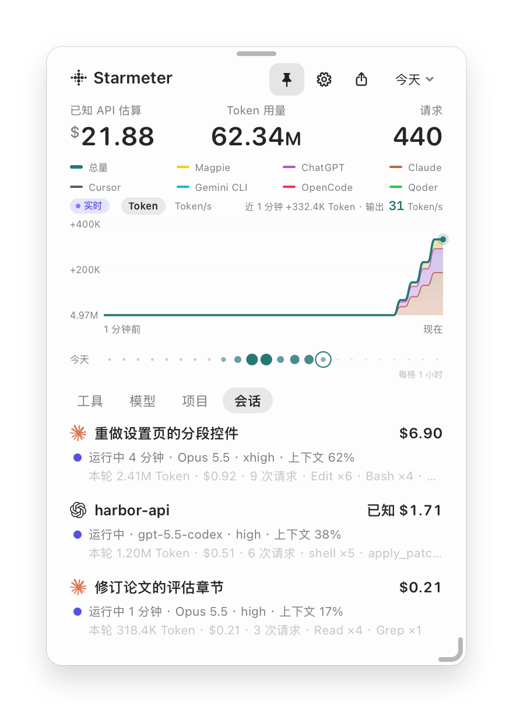
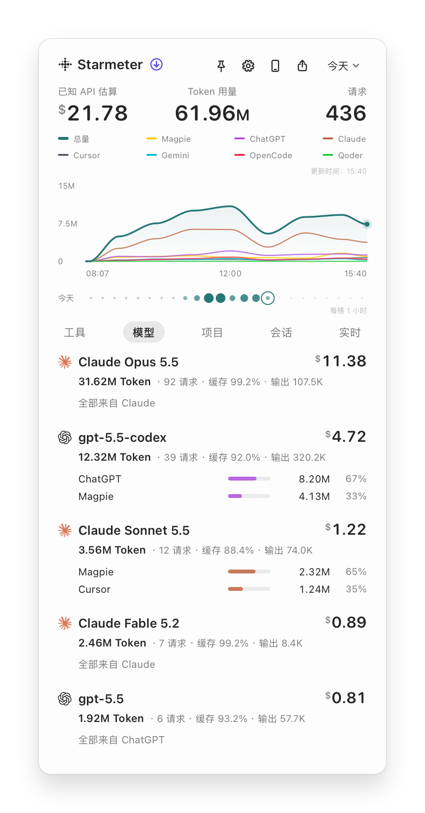
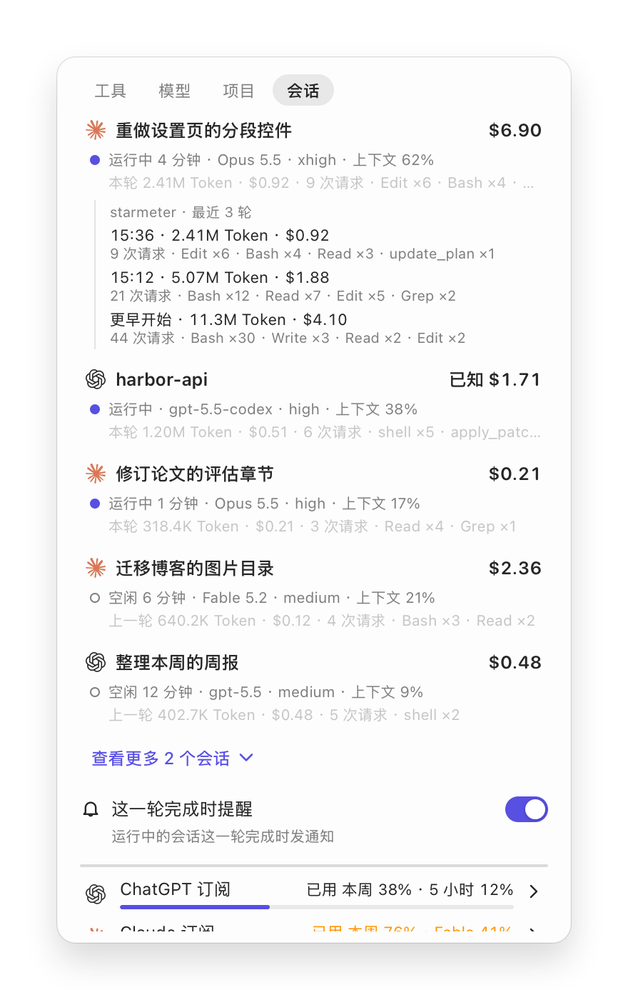
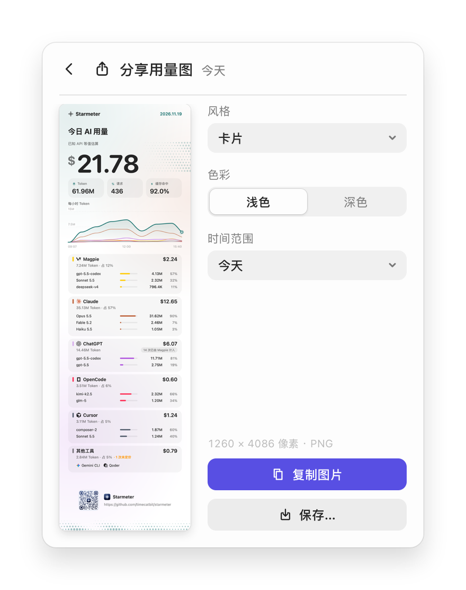
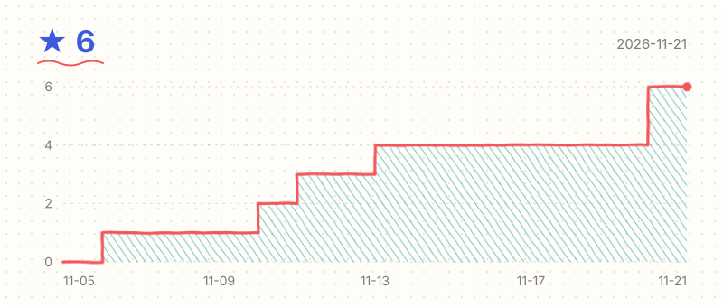

<p align="center"></p>

<h1 align="center">Starmeter</h1>

<p align="center"><b>在菜单栏一眼看清 AI 编程工具用了多少。</b><br>
各工具的 Token 和 API 等值费用、订阅额度、API 余额、正在跑的会话，点一下星星就在同一个面板里。</p>

<p align="center"><b>简体中文</b> · <a href="README.zh-Hant.md">繁體中文</a> · <a href="README.en.md">English</a> · <a href="https://timecatbit.github.io/starmeter/">网站</a> · <a href="#下载与安装">下载与安装</a></p>

> [!IMPORTANT]
> **Mac 用户请先用 SwiftBar 插件版。**
> 我还没有加入 Apple 开发者计划，独立版 DMG 暂时没有经过苹果签名和公证：第一次打开会被 macOS 拦下，要到“系统设置 → 隐私与安全性”里手动放行，之后的更新也可能要再放行一次。SwiftBar 插件版用的是同一个面板和同一套统计，装起来没有这一步，所以现在推荐先用它（[安装方法](#下载与安装)）。等我加入开发者计划、DMG 完成公证，会在这里更新，到时再换成独立版也不迟。

<p align="center">
  <picture><source media="(prefers-color-scheme: dark)" srcset="docs/images/home-dark.png"></picture>
  <picture><source media="(prefers-color-scheme: dark)" srcset="docs/images/subscription-dark.png"></picture>
  <picture><source media="(prefers-color-scheme: dark)" srcset="docs/images/live-dark.png"></picture>
</p>

Starmeter 是 macOS 菜单栏（独立 App 或 SwiftBar 插件）和 Windows、Linux 托盘里的一颗星星，终端里也能用 `starmeter` 命令看。它只读本机已有的用量记录和你启用的官方接口，不需要账号、不经过任何中转服务器。免费开源。界面有简体中文、繁體中文和英文，在“齿轮 → 通用 → 语言”切换。

原名 Token Monitor，设置和 Key 都会保留。从 6.0.2 起下载文件改名为 `starmeter-…`，6.0.1 及更早的版本收不到这次自动更新，请按下面的“[从 6.0.1 及更早版本升级](#从-601-及更早版本升级)”手动升级一次，之后照常自动更新。

## 能看什么

- **工具 Token 用量**：Claude（桌面 App 和 VS Code、JetBrains、终端里的 Claude Code）、ChatGPT（Codex）、OpenCodex、Magpie、OpenCode、DeepSeek Harness、WorkBuddy、Qoder（国内版 Qoder CN）、Gemini（Gemini CLI 和 Antigravity）、Cursor（桌面版和 Cursor CLI）。显示 Token、请求、缓存命中、模型分布、趋势图和用量热力图，并按模型官方价估算 API 等值费用。范围可选今天、昨天、近 24 小时、近 7/30 天、本周、本月或全部；卡片按用量从多到少排，可以按工具、按模型或按项目（会话所在的项目文件夹）查看。网关（Magpie、OpenCodex）和经过它的客户端会各记一遍同一请求，Summary 只算一次。工具自己清理掉的旧记录（Claude Code 默认只留 30 天）仍会计入，可以关闭。在 Windows 上，正在运行的 WSL 发行版里的 Claude Code 和 Codex 也一起统计。
- **订阅额度**：ChatGPT、Claude、MiniMax、Cursor、Gemini 显示已用百分比和重置时间，70% 起变橙、90% 起变红，并写出比匀速多用还是少用。ChatGPT、Claude 在主页并排画出 5 小时和本周两根条，Gemini 分成 Gemini 模型和 Claude、GPT 模型两行，各带自己的标志，名称右边写最紧的那个。窗口用完后改写还能接着花的余额（橙色）：ChatGPT 的 Credits、Claude 的额外用量、Cursor 的按需用量；ChatGPT 快用完时，条下写还能免费重置几次。Gemini 的额度来自本机运行的 Antigravity App，Qoder 读取 Qoder CN App 本机记录的 Credits 用量；Grok、Kimi 可以手动标记。填上每月订阅价后，侧栏写本月用量值订阅价的几倍（按 API 官方价估算）。
- **API 余额与花费**：DeepSeek、Kimi、Grok 显示余额；Qoder 用组织 API Key（团队版/企业版）显示组织共享的加购 Credits；Claude 显示本月花费（需要管理员 Key）；ChatGPT、Gemini 可以测试 Key 是否可用。每个 API 可以保存多把 Key，主页显示合计和 Key 数量，如“余额 ¥12.00 (3)”。
- **会话**：工具 / 模型 / 项目旁的第四个标签，列出所选统计范围里活动过的 Claude Code 与 Codex 会话，正在运行的和最新活跃的在前，先列 5 个，其余点“查看更多”。每个会话一张卡：这个会话在所选统计范围里花了多少（和其他标签同一口径，钉住时实时跳动）、是否正在运行、这一轮用了多少 Token、上下文用了多少，点开看整个会话的累计花费和最近几轮各用了多少 Token、费用和工具；可选在一轮完成时提醒。
- **钉住实时看**：点标题旁的图钉，面板浮在其他窗口之上，可以挪动、拉大；趋势图换成近 1 分钟的实时图，每个工具一条自己颜色的线（可切换累计 Token 或每秒输出的 Token/s；各工具量级相差很多时，纵轴自动换成对数刻度），下面自动切到正在跑的会话，每 1–5 秒按本机日志刷新。
- **分享图**：卡片、终端、手绘、报刊、夜空、地铁、织物、收据、蓝图、霓虹十种风格，每种都有浅色和深色，先预览，再复制或保存（Mac 还能直接分享）。图里只有 Summary 计入的用量，不含订阅、余额和 Key。
- **外观与语言**：浅色、深色或跟随系统，实色、磨砂或玻璃背景；也可以换成手绘风格（白天是点格纸上的彩色墨水，夜里是黑板上的粉笔，排版不变）。界面有简体中文、繁體中文和 English。
- **多台电脑合并**：在每台电脑的“齿轮 → 数据 → 多台电脑合并”里选同一个同步文件夹（iCloud 云盘、Dropbox、OneDrive 等），各自写下自己的用量，主页、菜单栏金额和导出都按合起来的数字显示，图表上方写“含 N 台电脑”。不经过任何服务器，文件里只有工具、模型和用量数字。
- **在手机上看**：齿轮里的“在手机上看”给出一个二维码，手机扫一下就在浏览器里看主页（只读，可以换统计范围、按工具/模型/项目分组、看会话、点进工具页，也能生成分享图存到相册或发给朋友）。默认在同一个网络里直连电脑；手机不在同一个网络时可选“任何网络”，确认后经 Cloudflare 生成临时外网链接（第一次要下载 cloudflared），一小时后关闭；同一个网络里一直开着，直到点“停止”或退出 App。
- **提醒**：订阅窗口用到 90%（可改为 70%、80% 或关闭）时发通知；余额类 API 可以按币种设置低于多少时提醒；可选在每周额度快重置却还没怎么用时提醒。
- **工具更新**：已勾选客户端有新版本时提醒，Claude Code 和 Codex CLI 可一键在终端更新。
- **其他**：菜单栏星星旁可选显示今天的 API 估算或最紧张的订阅额度；可设全局快捷键（如 ⌃⌥S，Windows 是 Ctrl+Alt+S），在任何地方按下即可打开或收起面板；当前范围的用量可导出成 CSV 或 JSON；可选读取 Claude、OpenAI、Cursor 的官方状态页，服务出问题时标在卡片上；API 等值估算可以改用人民币显示；Komari 服务器监控；浅色、深色或跟随系统。

<p align="center">
  <picture><source media="(prefers-color-scheme: dark)" srcset="docs/images/models-dark.png"></picture>
  <picture><source media="(prefers-color-scheme: dark)" srcset="docs/images/sessions-dark.png"></picture>
  <picture><source media="(prefers-color-scheme: dark)" srcset="docs/images/share-page-dark.png"></picture>
</p>

<p align="center"><sub>截图都用测试数据生成，不是真实用量。更多截图和十种分享图见 <a href="https://timecatbit.github.io/starmeter/">网站</a>。</sub></p>

## 下载与安装

从 [最新发布页](https://github.com/timecatbit/starmeter/releases/latest) 下载一个文件即可。发布页附件列表显示的是下表第二列的名字，下载后的文件名在第三列（X.Y.Z 是版本号）。

| 你的电脑 | 发布页上的名字 | 文件名 |
| --- | --- | --- |
| Mac，Apple M 系列芯片（未公证） | **Mac · Apple Silicon** | `starmeter-X.Y.Z-macos-apple-silicon.dmg` |
| Mac，Intel 处理器（未公证） | **Mac · Intel** | `starmeter-X.Y.Z-macos-intel.dmg` |
| Windows 10/11（推荐） | **Windows · Installer** | `starmeter-X.Y.Z-windows-x64-setup.exe` |
| Windows 10/11，不想安装 | **Windows · Portable** | `starmeter-X.Y.Z-windows-x64.zip` |
| Mac，现在推荐（需先装 SwiftBar） | **Mac · SwiftBar plugin** | `starmeter-X.Y.Z.zip`，不分芯片 |
| Ubuntu、Debian 等 | **Linux · Debian/Ubuntu** | `starmeter-X.Y.Z-linux-x64.deb` |
| 其他 Linux 发行版 | **Linux · AppImage** | `starmeter-X.Y.Z-linux-x64.AppImage` |
| 只要终端里的 [命令行](#命令行)，Mac | **Mac · Command line** | `starmeter-X.Y.Z-macos-cli.tar.gz`，不分芯片 |
| 只要终端里的 [命令行](#命令行)，Linux | **Linux · Command line** | `starmeter-X.Y.Z-linux-x64-cli.tar.gz` |

不确定 Mac 芯片？点屏幕左上角的苹果菜单 → **关于本机**：显示「芯片：Apple M…」选 Apple Silicon，显示「处理器：Intel…」选 Intel。每个文件旁的 `sha256:` 是 GitHub 给出的校验值，需要时可以和下载的文件比对。

### Mac：独立版还是 SwiftBar 插件？

两版用同一个面板和同一个编译好的用量引擎，支持 macOS 13 及以上，统计口径完全相同。

| | 独立版 DMG | SwiftBar 插件版 |
| --- | --- | --- |
| 优点 | 拖进「应用程序」即可安装；不用装 SwiftBar；可在星星右键设置登录启动 | 适合已经用 SwiftBar 管理多个插件的人；包更小；可在面板内更新插件 |
| 取舍 | 预览未公证，首次可能要手动放行；新版需下载 DMG 替换应用 | 需先装 SwiftBar；安装时要在终端用 `python3` 运行一次脚本，运行时不需要 Python |
| 适合 | 想用不依赖 SwiftBar 的独立应用 | 已经在用 SwiftBar，并希望保留现有插件管理方式 |

**独立版**：打开 DMG，把 **Starmeter** 拖到 **应用程序**，推出镜像，再从应用程序打开。**预览未做 Apple 公证**。若首次打开被拦，确认下载自项目发布页后，到「系统设置 → 隐私与安全性 → 仍要打开」。受公司管理的 Mac 可能无法放行。两版共用本机设置和 Key；从插件切换到独立版时，先在 SwiftBar 停用本插件，避免两个星星和重复提醒。

**用 Homebrew 装独立版**：会按芯片选对 DMG。

```sh
brew install --cask timecatbit/tap/starmeter
```

**插件版**：先安装 [SwiftBar](https://github.com/swiftbar/SwiftBar/releases/latest)（也可用 `brew install --cask swiftbar`），首次打开时选定插件目录。再下载并解压发布页上的 **Mac · SwiftBar plugin**，进入解压后的目录运行：

```sh
python3 install.py
```

安装器会找到 SwiftBar 插件目录，保留已有设置和备份；装好后菜单栏出现星星，下载包可以删除。需要从源码安装时，在仓库根目录运行 `python3 scripts/install.py`（需要 Rust、Node.js 和 Xcode 命令行工具）。

### Windows

**安装版**：运行 `…-windows-x64-setup.exe`。只装给当前用户，不需要管理员权限；较老的 Windows 10 缺少 WebView2 运行库时，安装程序会先替你装上。桌面快捷方式和登录启动可在安装时勾选。装好后星星出现在任务栏右下角的托盘里，点它打开面板。卸载会保留你的设置和 Key。

**免安装版**：解压 `…-windows-x64.zip`，运行里面的 `Starmeter.exe`。

设置保存在 `%LOCALAPPDATA%\Token Monitor`。

### Linux

**Ubuntu、Debian**：在下载目录运行 `sudo apt install ./starmeter-X.Y.Z-linux-x64.deb`，再从应用菜单打开 Starmeter。

**其他发行版**：给 `…-linux-x64.AppImage` 加上执行权限（`chmod +x`）后直接运行。

星星出现在顶栏或任务栏的托盘里。Linux 的托盘点一下只会弹出菜单，选第一项 **打开面板** 打开面板。GNOME 桌面需要托盘支持（Ubuntu 自带；其他发行版装 AppIndicator 扩展）。设置保存在 `~/.local/share/starmeter`。

## 更新

- **SwiftBar 插件**：有新版本时，主页“工具更新”下方会出现一行 **Starmeter**，右侧写着“可更新 X.Y.Z”。点“更新到 X.Y.Z”，确认后插件自动下载、校验并安装，设置、Key 和统计记录都会保留。没有新版本时这一行不显示。
- **Mac 独立版**：有适用当前芯片的新版本时，面板会链接到发布页。退出旧版，下载同芯片的新 DMG，再替换「应用程序」里的 App；用 Homebrew 安装的运行 `brew upgrade --cask starmeter`。
- **命令行**：用 Homebrew 安装的运行 `brew upgrade starmeter-cli`；`.deb` 和 Windows 版里的命令随应用一起更新。
- **价格表**：每天自动更新，新模型的价格不用等新版本。

### 从 6.0.1 及更早版本升级

6.0.2 起下载文件改名为 `starmeter-…`，6.0.1 及更早的版本按旧名字找更新，收不到这一版，需要手动升级一次；设置、Key 和统计记录都会保留。

- **SwiftBar 插件**：下载发布页上的 **Mac · SwiftBar plugin**，解压后在目录里运行 `python3 install.py`。
- **Mac 独立版**：退出旧版，下载同芯片的新 DMG，替换「应用程序」里的 App；用 Homebrew 安装的运行 `brew upgrade --cask starmeter`。
- **Windows**：从托盘退出旧版，运行新的 `starmeter-X.Y.Z-windows-x64-setup.exe` 覆盖安装；免安装版解压新的 zip 替换旧文件夹。

## 使用

- **左键星星**打开主页，默认显示今天。首次安装会在后台读取这台电脑已有的用量记录；选「全部」可以查看仍保存在本机的记录，不需要发起新调用。已经删除、从未同步到本机或没有记录 Token 的对话无法补算。
- 第一次打开时，面板会在主页上带你走一遍：欢迎页可以直接选简体中文、繁體中文或 English，接着依次点亮用量总览、统计范围、卡片、订阅与 API 和标题栏的按钮。这台电脑上还没找到任何工具时，指引改为说明去哪里勾选工具或自动检测；工具还在第一次读取时，会说明数字稍后自己出现。之后在“齿轮 → 通用 → 新手指引”可以再看。
- 标题旁依次是图钉（钉住）、齿轮（主页模块与设置）、分享和统计范围。点带箭头的行进入它的详情页，点返回、按 Esc 或触控板双指右滑回到主页。
- **右键星星 → 主页模块…** 选择要显示的模块，并设置记录目录、Key 和连接；**自动检测…** 按本机已安装的工具重新勾选模块，确认前不会改动任何设置。
- **调整主页顺序**：按住订阅、API 等行片刻，它会浮起，在所在分组里拖到想要的位置，松手即保存；也可以选中一行后按 ⌥↑ / ⌥↓（Windows、Linux 是 Alt+↑ / Alt+↓）。工具卡片仍按用量排。“齿轮 → 通用 → 主页顺序”可以恢复默认顺序。
- **网关**：Magpie 读取本机的 `usage.jsonl`（默认 `~/.config/magpie`），OpenCodex 读取它自己的日志。同时勾选网关和经过它的客户端（如 ChatGPT、Claude）时，经过网关的请求只按网关计入 Summary，客户端卡片照常显示自己的全部记录并注明“N 次已由 Magpie 计入”。ChatGPT 桌面版的预测消息等附加调用不写进本机的 Codex 记录，只在经过 Magpie 时才统计得到，所以 Magpie 里 ChatGPT 的请求可能比 ChatGPT 卡片多。
- **DeepSeek Harness** 默认读取 `~/.dsh/sessions`（设置了 `DSH_HOME` 时读其 `sessions` 子目录），也可手选目录。
- Mac 的高级设置写在 `~/Library/Application Support/SwiftBarToken/config.local.sh`，可用的变量见 [config.example.sh](config.example.sh)。如果命令行工具只在终端初始化时加入 PATH（例如通过 nvm 安装），可在这个文件里把对应的 `bin` 目录加进 PATH。

## 命令行

不打开面板，在终端里也能看用量：`starmeter` 打出今天的 Summary、各工具和订阅额度。它和面板用同一套统计、同样的设置与缓存，数字一致。

```sh
starmeter                      # 今天概览：Summary、各工具、订阅与额度
starmeter usage 7d             # 近 7 天的用量与趋势
starmeter usage -g model -d    # 按模型分组，列出每张卡片的明细
starmeter quota                # 订阅额度与 API 余额，带各窗口的重置时间
starmeter detect               # 检测本机的工具，把新找到的加到主页
starmeter usage 30d --json     # 给脚本用的 JSON
```

**安装**

- **Mac 和 Linux**：用 Homebrew，不必装 App。

  ```sh
  brew install timecatbit/tap/starmeter-cli
  ```

- **Ubuntu、Debian**：装了 `.deb` 就有 `starmeter` 命令。
- **Windows**：安装版和免安装版的 `bin` 文件夹里有 `starmeter.cmd`。把这个文件夹（安装版在 `%LOCALAPPDATA%\Programs\Starmeter\bin`）加入 PATH，就能在任何地方输入 `starmeter`。
- **手动**：下载发布页上的 **Mac · Command line** 或 **Linux · Command line**，解压后把 `starmeter` 所在的文件夹加入 PATH，旁边的 `lib` 一起保留。Mac 上用浏览器下载的压缩包未经 Apple 公证，首次运行会被系统拦下，推荐用 Homebrew。

**说明**

- 统计范围与主页相同：`today`（默认）、`yesterday`、`24h`、`7d`、`30d`、`week`、`month`、`all`；分组：`tool`（默认）、`model`、`project`。范围和分组可以直接写在命令后，也可以用 `-r`、`-g`。
- 设置、连接和缓存与这台电脑上的 Starmeter 共用，统计时区、货币和汇率、主页勾选的模块都跟面板一致；主页没有勾选的工具不出现。
- 只装命令行时，第一次运行会像 App 第一次打开一样自动检测本机的工具。之后装了新工具，运行 `starmeter detect` 看看找到了什么，加 `--yes` 把新找到的加到主页；已有的勾选不会改动。
- 订阅额度、API 余额像打开面板时一样，到期才联网刷新；加 `--no-refresh` 直接用上次的结果。
- 语言跟随系统（系统是繁体中文时用繁體中文），可用 `--lang zh|zh-Hant|en` 或环境变量 `STARMETER_LANG` 指定。输出到管道或文件时不上色，`--color always|never` 可以改；终端变窄时依次收起占比条、缓存和请求列。
- `--json` 的键名固定为英文：`summary`（费用、Token、请求、缓存命中率）、`trend`、`tools`、`groups`（按模型或项目分组时）、`quotas`（订阅与 API）。费用同时给出面板所用货币的 `cost` 和美元的 `costUsd`。

## 隐私

- 本机日志只读取，只记录用量数字；项目只记文件夹名。不保存对话内容。
- Key 只保存在本机，文件只有你自己能读，界面上不显示 Key 内容。
- Claude 订阅用量只在你启用后，用本机 Claude Code 的登录向 Anthropic 的用量接口查询；令牌只在内存里，不刷新、不写回。
- Cursor 的用量读取默认关闭。开启后只读取本机已保存的 Cursor 登录，令牌只在内存里、只发往 cursor.com 查询本账户的用量记录，不保存、不刷新、不改写。
- Gemini 订阅的额度只向这台电脑上正在运行的 Antigravity App 询问（127.0.0.1），用它在本机记下的临时令牌，令牌只用于这次请求，不保存。
- 只向你启用的服务的官方接口查询。另外每天从 GitHub 检查一次价格表和插件新版本，请求不带 Cookie 或任何标识；不需要的话，在 `config.local.sh` 加 `export OCX_PRICING_UPDATES=0` 或 `export OCX_SELF_UPDATES=0` 即可关闭。GitHub 连不上时，检查和下载改经公共镜像（ghfast.top 等，也可用 `STARMETER_GITHUB_MIRRORS` 指定自己的），安装包仍按 GitHub 公布的 SHA-256 校验。服务状态页和人民币汇率只在你开启后才读取。
- 多台电脑合并只写到你自己选的同步文件夹，由你的网盘同步，Starmeter 不经过任何服务器；文件里只有电脑名称、工具、模型和用量数字，没有路径、项目、对话或 Key。
- 在手机上看时，数据只在局域网里从这台电脑直接发到手机，链接带一次性口令，没有口令打不开；只有选了“任何网络”才经过 Cloudflare 的临时链接（第一次从 GitHub 下载 cloudflared），一小时后关闭；点“停止”或退出 App 时全部关闭。
- 费用是按官方 API 价格算出的等值估算，不是你的订阅账单；没有价格的模型只统计 Token，不会凭空填个零。

## 开发

Rust 引擎（`crates/`）负责全部统计，Tauri 应用（`app/src-tauri`）提供星星、托盘和窗口，面板界面在 `app/ui`（Svelte）。

```sh
python3 scripts/check.py    # 界面检查与构建、Rust 和 Python 测试
python3 scripts/install.py  # 编译并安装到 SwiftBar
python3 scripts/package.py  # 打包发布 zip
node docs/screenshots.mjs   # 用测试数据重新生成截图
```

发布新版本：`Cargo.toml` 工作区、`app/src-tauri/tauri.conf.json`、`app/package.json` 和入口文件 `xbar.version` 的版本号保持一致，CHANGELOG 写好这一版，然后推送 `v版本号` 标签，GitHub Actions 会自动打包并发布。维护约定见 [AGENTS.md](AGENTS.md)，更新记录见 [CHANGELOG.md](CHANGELOG.md)。

## Star 趋势

<a href="https://github.com/timecatbit/starmeter/stargazers">
  <picture>
    <source media="(prefers-color-scheme: dark)" srcset="https://raw.githubusercontent.com/timecatbit/starmeter/stars/stars-dark.svg">
    
  </picture>
</a>

## 许可

[MIT](LICENSE) © timecatbit。品牌标志归各自所有者，仅用于标识服务，图标文件的许可见 [assets/logos/LICENSE](assets/logos/LICENSE)。手绘风格的中文字体霞鹜文楷和霞鹜文楷 TC 使用 SIL Open Font License 1.1，随 App 打包的是它们的网页子集，许可文本随字体放在 [app/ui/public/fonts](app/ui/public/fonts)。
