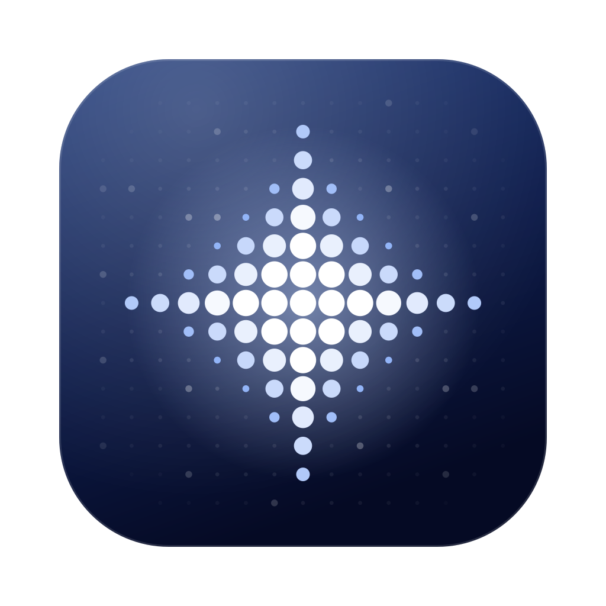
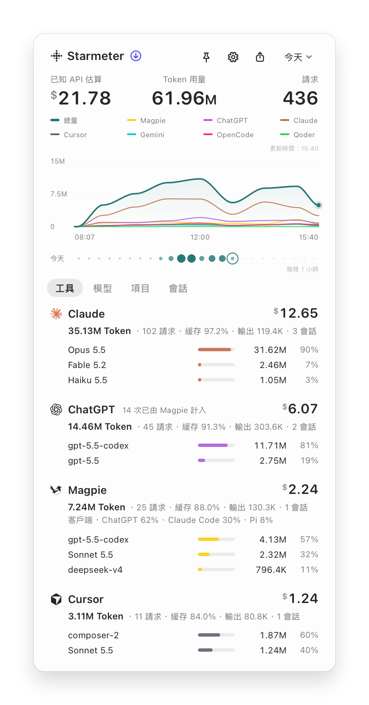
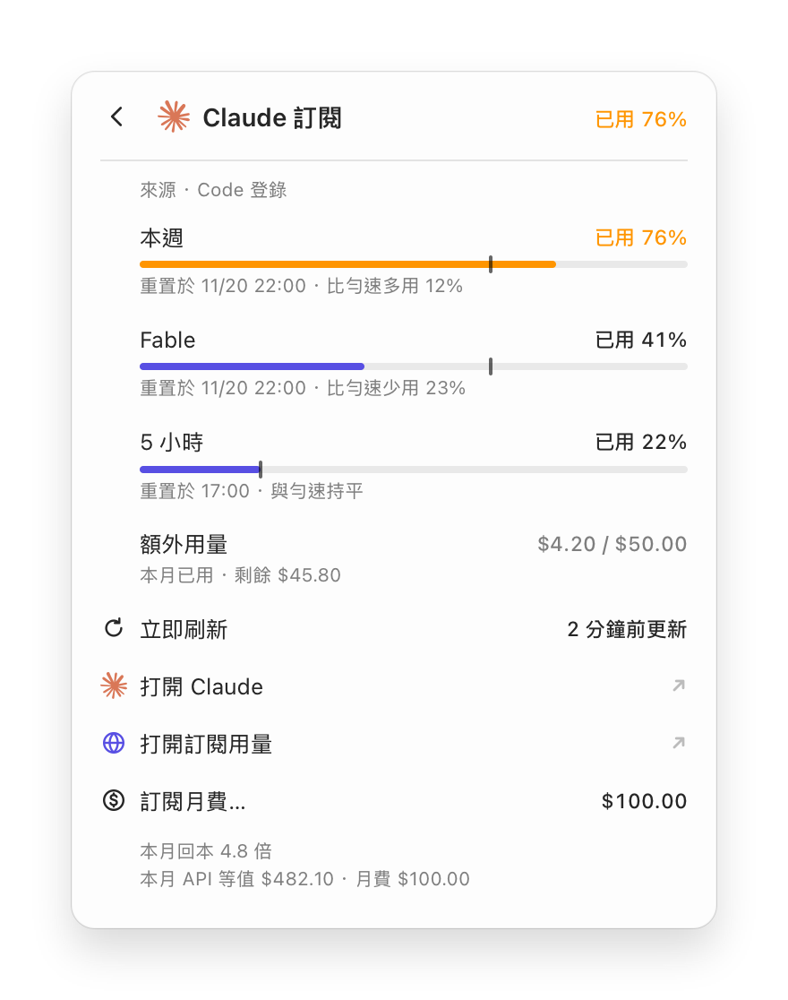
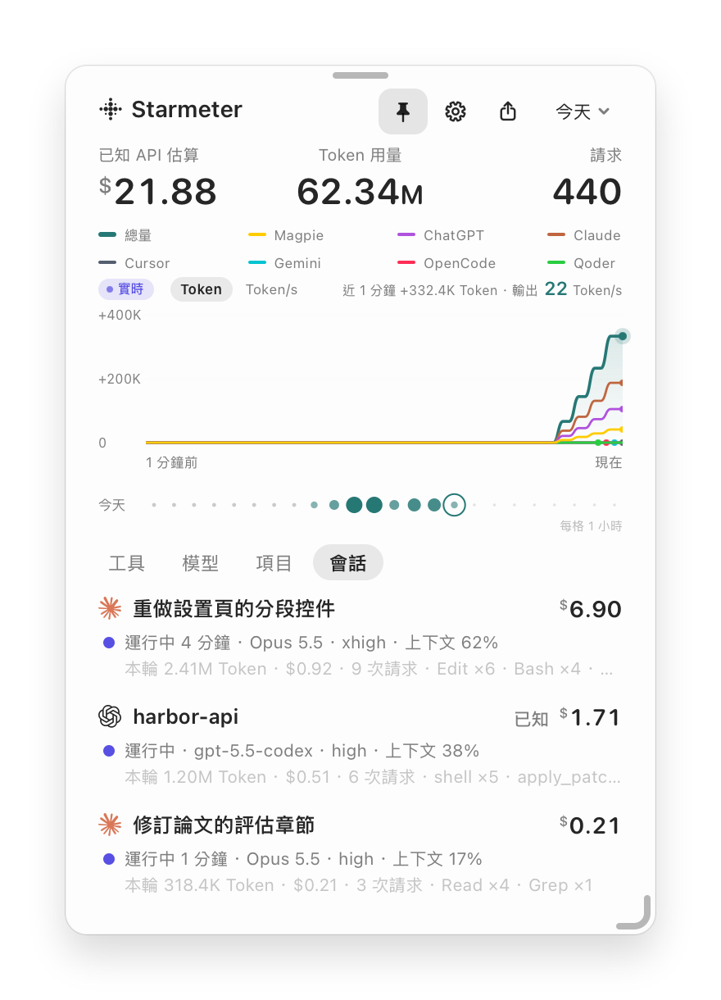
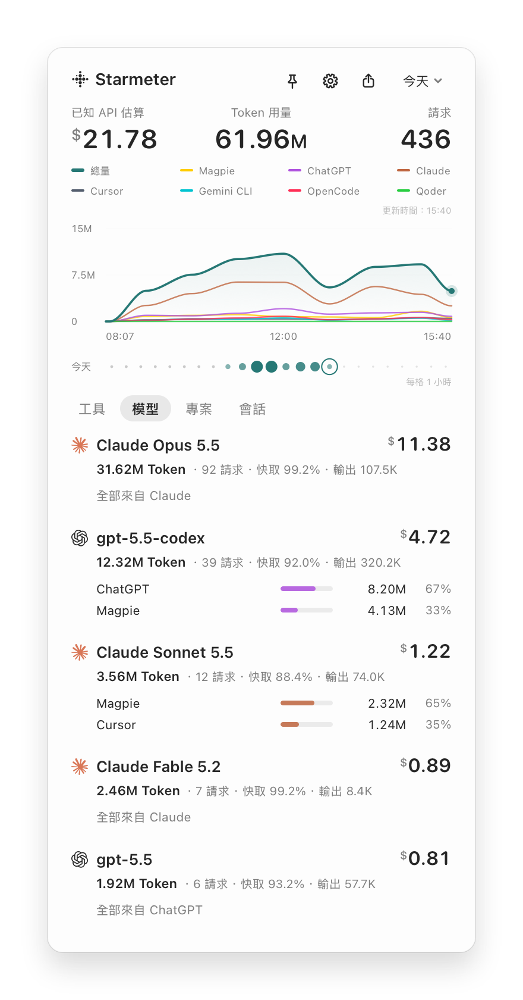
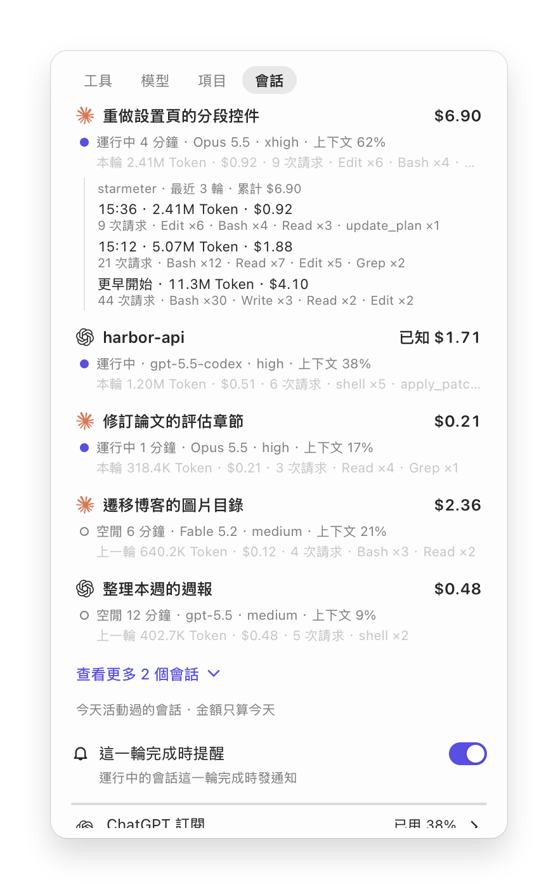
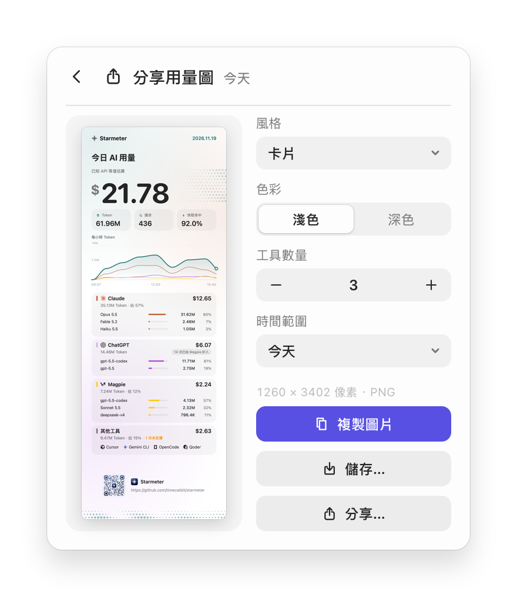

<p align="center"></p>

<h1 align="center">Starmeter</h1>

<p align="center"><b>在選單欄一眼看清 AI 編程工具用了多少。</b><br>
各工具的 Token 和 API 等值費用、訂閱額度、API 餘額、正在跑的會話，點一下星星就在同一個面板裡。</p>

<p align="center"><a href="README.md">简体中文</a> · <b>繁體中文</b> · <a href="README.en.md">English</a> · <a href="https://timecatbit.github.io/starmeter/">網站</a> · <a href="#下載與安裝">下載與安裝</a></p>

> [!IMPORTANT]
> **Mac 使用者請先用 SwiftBar 外掛版。**
> 我還沒有加入 Apple 開發者計劃，獨立版 DMG 暫時沒有經過蘋果簽名和公證：第一次打開會被 macOS 攔下，要到“系統設定 → 隱私與安全性”裡手動放行，之後的更新也可能要再放行一次。SwiftBar 外掛版用的是同一個面板和同一套統計，裝起來沒有這一步，所以現在推薦先用它（[安裝方法](#下載與安裝)）。等我加入開發者計劃、DMG 完成公證，會在這裡更新，到時再換成獨立版也不遲。

<p align="center">
  <picture><source media="(prefers-color-scheme: dark)" srcset="docs/images/zh-Hant/home-dark.png"></picture>
  <picture><source media="(prefers-color-scheme: dark)" srcset="docs/images/zh-Hant/subscription-dark.png"></picture>
  <picture><source media="(prefers-color-scheme: dark)" srcset="docs/images/zh-Hant/live-dark.png"></picture>
</p>

Starmeter 是 macOS 選單欄（獨立 App 或 SwiftBar 外掛）和 Windows、Linux 托盤裡的一顆星星，終端裡也能用 `starmeter` 命令看。它只讀本機已有的用量記錄和你啟用的官方接口，不需要帳號、不經過任何中轉伺服器。免費開源。介面有簡體中文、繁體中文和英文，在“齒輪 → 通用 → 語言”切換。

原名 Token Monitor，設定和 Key 都會保留。從 6.0.2 起下載檔案改名為 `starmeter-…`，6.0.1 及更早的版本收不到這次自動更新，請按下面的“[從 6.0.1 及更早版本升級](#從-601-及更早版本升級)”手動升級一次，之後照常自動更新。

## 能看什麼

- **工具 Token 用量**：Claude（桌面 App 和 VS Code、JetBrains、終端裡的 Claude Code）、ChatGPT（Codex）、OpenCodex、Magpie、OpenCode、DeepSeek Harness、WorkBuddy、Qoder（國內版 Qoder CN）、Gemini CLI、Cursor（桌面版和 Cursor CLI）。顯示 Token、請求、快取命中、模型分布、趨勢圖和用量熱力圖，並按模型官方價估算 API 等值費用。範圍可選今天、昨天、近 24 小時、近 7/30 天、本週、本月或全部；卡片按用量從多到少排，可以按工具、按模型或按專案（會話所在的專案資料夾）查看。網關（Magpie、OpenCodex）和經過它的客戶端會各記一遍同一請求，Summary 只算一次。工具自己清理掉的舊記錄（Claude Code 預設只留 30 天）仍會計入，可以關閉。在 Windows 上，正在執行的 WSL 發行版裡的 Claude Code 和 Codex 也一起統計。
- **訂閱額度**：ChatGPT、Claude、MiniMax、Cursor 顯示已用百分比和重置時間，70% 起變橙、90% 起變紅，並寫出比勻速多用還是少用；Qoder 讀取 Qoder CN App 本機記錄的 Credits 用量；Gemini、Grok、Kimi 可以手動標記。填上每月訂閱價後，側欄寫本月用量值訂閱價的幾倍（按 API 官方價估算）。
- **API 餘額與花費**：DeepSeek、Kimi、Grok 顯示餘額；Qoder 用組織 API Key（團隊版/企業版）顯示組織共享的加購 Credits；Claude 顯示本月花費（需要管理員 Key）；ChatGPT、Gemini 可以測試 Key 是否可用。每個 API 可以儲存多把 Key，主頁顯示合計和 Key 數量，如“餘額 ¥12.00 (3)”。
- **會話**：工具 / 模型 / 專案旁的第四個標籤，列出所選統計範圍裡活動過的 Claude Code 與 Codex 會話，正在執行的和最新活躍的在前，先列 5 個，其餘點“查看更多”。每個會話一張卡：這個會話在所選統計範圍裡花了多少（和其他標籤同一口徑，釘住時即時跳動）、是否正在執行、這一輪用了多少 Token、上下文用了多少，點開看整個會話的累計花費和最近幾輪各用了多少 Token、費用和工具；可選在一輪完成時提醒。
- **釘住即時看**：點標題旁的圖釘，面板浮在其他視窗之上，可以挪動、拉大；趨勢圖換成近 1 分鐘的即時圖（可切換累計 Token 或每秒輸出的 Token/s），下面自動切到正在跑的會話，每 1–5 秒按本機日誌刷新。
- **分享圖**：卡片、終端、手繪、報刊、夜空、地鐵、織物、收據、藍圖、霓虹十種風格，每種都有淺色和深色，先預覽，再複製或儲存（Mac 還能直接分享）。圖裡只有 Summary 計入的用量，不含訂閱、餘額和 Key。
- **外觀與語言**：淺色、深色或跟隨系統，實色、磨砂或玻璃背景；也可以換成手繪風格（白天是點格紙上的彩色墨水，夜裡是黑板上的粉筆，排版不變）。介面有簡體中文、繁體中文和 English。
- **多台電腦合併**：在每台電腦的“齒輪 → 資料 → 多台電腦合併”裡選同一個同步資料夾（iCloud 雲盤、Dropbox、OneDrive 等），各自寫下自己的用量，主頁、選單欄金額和匯出都按合起來的數字顯示，圖表上方寫“含 N 台電腦”。不經過任何伺服器，檔案裡只有工具、模型和用量數字。
- **在手機上看**：齒輪裡的“在手機上看”給出一個QR碼，手機掃一下就在瀏覽器裡看主頁（只讀，可以換統計範圍、按工具/模型/專案分組、看會話、點進工具頁，也能生成分享圖存到相冊或發給朋友）。預設在同一個網路裡直連電腦；手機不在同一個網路時可選“任何網路”，確認後經 Cloudflare 生成臨時外網連結（第一次要下載 cloudflared），一小時後關閉；同一個網路裡一直開著，直到點“停止”或退出 App。
- **提醒**：訂閱視窗用到 90%（可改為 70%、80% 或關閉）時發通知；餘額類 API 可以按幣種設定低於多少時提醒；可選在每週額度快重置卻還沒怎麼用時提醒。
- **工具更新**：已勾選客戶端有新版本時提醒，Claude Code 和 Codex CLI 可一鍵在終端更新。
- **其他**：選單欄星星旁可選顯示今天的 API 估算或最緊張的訂閱額度；可設全局快捷鍵（如 ⌃⌥S，Windows 是 Ctrl+Alt+S），在任何地方按下即可打開或收起面板；當前範圍的用量可匯出成 CSV 或 JSON；可選讀取 Claude、OpenAI、Cursor 的官方狀態頁，服務出問題時標在卡片上；API 等值估算可以改用人民幣顯示；Komari 伺服器監控；淺色、深色或跟隨系統。

<p align="center">
  <picture><source media="(prefers-color-scheme: dark)" srcset="docs/images/zh-Hant/models-dark.png"></picture>
  <picture><source media="(prefers-color-scheme: dark)" srcset="docs/images/zh-Hant/sessions-dark.png"></picture>
  <picture><source media="(prefers-color-scheme: dark)" srcset="docs/images/zh-Hant/share-page-dark.png"></picture>
</p>

<p align="center"><sub>截圖都用測試資料生成，不是真實用量。更多截圖和十種分享圖見 <a href="https://timecatbit.github.io/starmeter/">網站</a>。</sub></p>

## 下載與安裝

從 [最新發佈頁](https://github.com/timecatbit/starmeter/releases/latest) 下載一個檔案即可。發佈頁附件列表顯示的是下表第二列的名字，下載後的檔案名在第三列（X.Y.Z 是版本號）。

| 你的電腦 | 發佈頁上的名字 | 檔案名 |
| --- | --- | --- |
| Mac，Apple M 系列芯片（未公證） | **Mac · Apple Silicon** | `starmeter-X.Y.Z-macos-apple-silicon.dmg` |
| Mac，Intel 處理器（未公證） | **Mac · Intel** | `starmeter-X.Y.Z-macos-intel.dmg` |
| Windows 10/11（推薦） | **Windows · Installer** | `starmeter-X.Y.Z-windows-x64-setup.exe` |
| Windows 10/11，不想安裝 | **Windows · Portable** | `starmeter-X.Y.Z-windows-x64.zip` |
| Mac，現在推薦（需先裝 SwiftBar） | **Mac · SwiftBar plugin** | `starmeter-X.Y.Z.zip`，不分芯片 |
| Ubuntu、Debian 等 | **Linux · Debian/Ubuntu** | `starmeter-X.Y.Z-linux-x64.deb` |
| 其他 Linux 發行版 | **Linux · AppImage** | `starmeter-X.Y.Z-linux-x64.AppImage` |
| 只要終端裡的 [命令列](#命令列)，Mac | **Mac · Command line** | `starmeter-X.Y.Z-macos-cli.tar.gz`，不分芯片 |
| 只要終端裡的 [命令列](#命令列)，Linux | **Linux · Command line** | `starmeter-X.Y.Z-linux-x64-cli.tar.gz` |

不確定 Mac 芯片？點螢幕左上角的蘋果選單 → **關於本機**：顯示「芯片：Apple M…」選 Apple Silicon，顯示「處理器：Intel…」選 Intel。每個檔案旁的 `sha256:` 是 GitHub 給出的校驗值，需要時可以和下載的檔案比對。

### Mac：獨立版還是 SwiftBar 外掛？

兩版用同一個面板和同一個編譯好的用量引擎，支援 macOS 13 及以上，統計口徑完全相同。

| | 獨立版 DMG | SwiftBar 外掛版 |
| --- | --- | --- |
| 優點 | 拖進「應用程式」即可安裝；不用裝 SwiftBar；可在星星右鍵設定登入啟動 | 適合已經用 SwiftBar 管理多個外掛的人；包更小；可在面板內更新外掛 |
| 取捨 | 預覽未公證，首次可能要手動放行；新版需下載 DMG 替換應用 | 需先裝 SwiftBar；安裝時要在終端用 `python3` 執行一次腳本，執行時不需要 Python |
| 適合 | 想用不依賴 SwiftBar 的獨立應用 | 已經在用 SwiftBar，並希望保留現有外掛管理方式 |

**獨立版**：打開 DMG，把 **Starmeter** 拖到 **應用程式**，推出鏡像，再從應用程式打開。**預覽未做 Apple 公證**。若首次打開被攔，確認下載自專案發佈頁後，到「系統設定 → 隱私與安全性 → 仍要打開」。受公司管理的 Mac 可能無法放行。兩版共用本機設定和 Key；從外掛切換到獨立版時，先在 SwiftBar 停用本外掛，避免兩個星星和重復提醒。

**用 Homebrew 裝獨立版**：會按芯片選對 DMG。

```sh
brew install --cask timecatbit/tap/starmeter
```

**外掛版**：先安裝 [SwiftBar](https://github.com/swiftbar/SwiftBar/releases/latest)（也可用 `brew install --cask swiftbar`），首次打開時選定外掛目錄。再下載並解壓發佈頁上的 **Mac · SwiftBar plugin**，進入解壓後的目錄執行：

```sh
python3 install.py
```

安裝器會找到 SwiftBar 外掛目錄，保留已有設定和備份；裝好後選單欄出現星星，下載包可以刪除。需要從源碼安裝時，在倉庫根目錄執行 `python3 scripts/install.py`（需要 Rust、Node.js 和 Xcode 命令列工具）。

### Windows

**安裝版**：執行 `…-windows-x64-setup.exe`。只裝給當前使用者，不需要管理員權限；較老的 Windows 10 缺少 WebView2 執行庫時，安裝程式會先替你裝上。桌面快捷方式和登入啟動可在安裝時勾選。裝好後星星出現在任務欄右下角的托盤裡，點它打開面板。卸載會保留你的設定和 Key。

**免安裝版**：解壓 `…-windows-x64.zip`，執行裡面的 `Starmeter.exe`。

設定儲存在 `%LOCALAPPDATA%\Token Monitor`。

### Linux

**Ubuntu、Debian**：在下載目錄執行 `sudo apt install ./starmeter-X.Y.Z-linux-x64.deb`，再從應用選單打開 Starmeter。

**其他發行版**：給 `…-linux-x64.AppImage` 加上執行權限（`chmod +x`）後直接執行。

星星出現在頂欄或任務欄的托盤裡。Linux 的托盤點一下只會彈出選單，選第一項 **打開面板** 打開面板。GNOME 桌面需要托盤支援（Ubuntu 自帶；其他發行版裝 AppIndicator 擴展）。設定儲存在 `~/.local/share/starmeter`。

## 更新

- **SwiftBar 外掛**：有新版本時，主頁“工具更新”下方會出現一行 **Starmeter**，右側寫著“可更新 X.Y.Z”。點“更新到 X.Y.Z”，確認後外掛自動下載、校驗並安裝，設定、Key 和統計記錄都會保留。沒有新版本時這一行不顯示。
- **Mac 獨立版**：有適用當前芯片的新版本時，面板會連結到發佈頁。退出舊版，下載同芯片的新 DMG，再替換「應用程式」裡的 App；用 Homebrew 安裝的執行 `brew upgrade --cask starmeter`。
- **命令列**：用 Homebrew 安裝的執行 `brew upgrade starmeter-cli`；`.deb` 和 Windows 版裡的命令隨應用一起更新。
- **價格表**：每天自動更新，新模型的價格不用等新版本。

### 從 6.0.1 及更早版本升級

6.0.2 起下載檔案改名為 `starmeter-…`，6.0.1 及更早的版本按舊名字找更新，收不到這一版，需要手動升級一次；設定、Key 和統計記錄都會保留。

- **SwiftBar 外掛**：下載發佈頁上的 **Mac · SwiftBar plugin**，解壓後在目錄裡執行 `python3 install.py`。
- **Mac 獨立版**：退出舊版，下載同芯片的新 DMG，替換「應用程式」裡的 App；用 Homebrew 安裝的執行 `brew upgrade --cask starmeter`。
- **Windows**：從托盤退出舊版，執行新的 `starmeter-X.Y.Z-windows-x64-setup.exe` 覆蓋安裝；免安裝版解壓新的 zip 替換舊資料夾。

## 使用

- **左鍵星星**打開主頁，預設顯示今天。首次安裝會在後台讀取這台電腦已有的用量記錄；選「全部」可以查看仍儲存在本機的記錄，不需要發起新調用。已經刪除、從未同步到本機或沒有記錄 Token 的對話無法補算。
- 第一次打開時，面板會在主頁上帶你走一遍：歡迎頁可以直接選簡體中文、繁體中文或 English，接著依次點亮用量總覽、統計範圍、卡片、訂閱與 API 和標題欄的按鈕。這台電腦上還沒找到任何工具時，指引改為說明去哪裡勾選工具或自動檢測；工具還在第一次讀取時，會說明數字稍後自己出現。之後在“齒輪 → 通用 → 新手指引”可以再看。
- 標題旁依次是圖釘（釘住）、齒輪（主頁模組與設定）、分享和統計範圍。點帶箭頭的行進入它的詳情頁，點返回、按 Esc 或觸控板雙指右滑回到主頁。
- **右鍵星星 → 主頁模組…** 選擇要顯示的模組，並設定記錄目錄、Key 和連接；**自動檢測…** 按本機已安裝的工具重新勾選模組，確認前不會改動任何設定。
- **網關**：Magpie 讀取本機的 `usage.jsonl`（預設 `~/.config/magpie`），OpenCodex 讀取它自己的日誌。同時勾選網關和經過它的客戶端（如 ChatGPT、Claude）時，經過網關的請求只按網關計入 Summary，客戶端卡片照常顯示自己的全部記錄並注明“N 次已由 Magpie 計入”。ChatGPT 桌面版的預測消息等附加調用不寫進本機的 Codex 記錄，只在經過 Magpie 時才統計得到，所以 Magpie 裡 ChatGPT 的請求可能比 ChatGPT 卡片多。
- **DeepSeek Harness** 預設讀取 `~/.dsh/sessions`（設定了 `DSH_HOME` 時讀其 `sessions` 子目錄），也可手選目錄。
- Mac 的進階設定寫在 `~/Library/Application Support/SwiftBarToken/config.local.sh`，可用的變量見 [config.example.sh](config.example.sh)。如果命令列工具只在終端初始化時加入 PATH（例如透過 nvm 安裝），可在這個檔案裡把對應的 `bin` 目錄加進 PATH。

## 命令列

不打開面板，在終端裡也能看用量：`starmeter` 打出今天的 Summary、各工具和訂閱額度。它和面板用同一套統計、同樣的設定與快取，數字一致。

```sh
starmeter                      # 今天概覽：Summary、各工具、訂閱與額度
starmeter usage 7d             # 近 7 天的用量與趨勢
starmeter usage -g model -d    # 按模型分組，列出每張卡片的明細
starmeter quota                # 訂閱額度與 API 餘額，帶各視窗的重置時間
starmeter detect               # 檢測本機的工具，把新找到的加到主頁
starmeter usage 30d --json     # 給腳本用的 JSON
```

**安裝**

- **Mac 和 Linux**：用 Homebrew，不必裝 App。

  ```sh
  brew install timecatbit/tap/starmeter-cli
  ```

- **Ubuntu、Debian**：裝了 `.deb` 就有 `starmeter` 命令。
- **Windows**：安裝版和免安裝版的 `bin` 資料夾裡有 `starmeter.cmd`。把這個資料夾（安裝版在 `%LOCALAPPDATA%\Programs\Starmeter\bin`）加入 PATH，就能在任何地方輸入 `starmeter`。
- **手動**：下載發佈頁上的 **Mac · Command line** 或 **Linux · Command line**，解壓後把 `starmeter` 所在的資料夾加入 PATH，旁邊的 `lib` 一起保留。Mac 上用瀏覽器下載的壓縮包未經 Apple 公證，首次執行會被系統攔下，推薦用 Homebrew。

**說明**

- 統計範圍與主頁相同：`today`（預設）、`yesterday`、`24h`、`7d`、`30d`、`week`、`month`、`all`；分組：`tool`（預設）、`model`、`project`。範圍和分組可以直接寫在命令後，也可以用 `-r`、`-g`。
- 設定、連接和快取與這台電腦上的 Starmeter 共用，統計時區、貨幣和匯率、主頁勾選的模組都跟面板一致；主頁沒有勾選的工具不出現。
- 只裝命令列時，第一次執行會像 App 第一次打開一樣自動檢測本機的工具。之後裝了新工具，執行 `starmeter detect` 看看找到了什麼，加 `--yes` 把新找到的加到主頁；已有的勾選不會改動。
- 訂閱額度、API 餘額像打開面板時一樣，到期才聯網刷新；加 `--no-refresh` 直接用上次的結果。
- 語言跟隨系統（台灣、香港、澳門的系統用繁體中文），可用 `--lang zh|zh-Hant|en` 或環境變量 `STARMETER_LANG` 指定。輸出到管道或檔案時不上色，`--color always|never` 可以改；終端變窄時依次收起佔比條、快取和請求列。
- `--json` 的鍵名固定為英文：`summary`（費用、Token、請求、快取命中率）、`trend`、`tools`、`groups`（按模型或專案分組時）、`quotas`（訂閱與 API）。費用同時給出面板所用貨幣的 `cost` 和美元的 `costUsd`。

## 隱私

- 本機日誌只讀取，只記錄用量數字；專案只記資料夾名。不儲存對話內容。
- Key 只儲存在本機，檔案只有你自己能讀，介面上不顯示 Key 內容。
- Claude 訂閱用量只在你啟用後，用本機 Claude Code 的登入向 Anthropic 的用量接口查詢；令牌只在內存裡，不刷新、不寫回。
- Cursor 的用量讀取預設關閉。開啟後只讀取本機已儲存的 Cursor 登入，令牌只在內存裡、只發往 cursor.com 查詢本帳戶的用量記錄，不儲存、不刷新、不改寫。
- 只向你啟用的服務的官方接口查詢。另外每天從 GitHub 檢查一次價格表和外掛新版本，請求不帶 Cookie 或任何標識；不需要的話，在 `config.local.sh` 加 `export OCX_PRICING_UPDATES=0` 或 `export OCX_SELF_UPDATES=0` 即可關閉。服務狀態頁和人民幣匯率只在你開啟後才讀取。
- 多台電腦合併只寫到你自己選的同步資料夾，由你的網盤同步，Starmeter 不經過任何伺服器；檔案裡只有電腦名稱、工具、模型和用量數字，沒有路徑、專案、對話或 Key。
- 在手機上看時，資料只在區域網裡從這台電腦直接發到手機，連結帶一次性口令，沒有口令打不開；只有選了“任何網路”才經過 Cloudflare 的臨時連結（第一次從 GitHub 下載 cloudflared），一小時後關閉；點“停止”或退出 App 時全部關閉。
- 費用是按官方 API 價格算出的等值估算，不是你的訂閱賬單；沒有價格的模型只統計 Token，不會憑空填個零。

## 開發

Rust 引擎（`crates/`）負責全部統計，Tauri 應用（`app/src-tauri`）提供星星、托盤和視窗，面板介面在 `app/ui`（Svelte）。

```sh
python3 scripts/check.py    # 介面檢查與構建、Rust 和 Python 測試
python3 scripts/install.py  # 編譯並安裝到 SwiftBar
python3 scripts/package.py  # 打包發佈 zip
node docs/screenshots.mjs   # 用測試資料重新生成截圖
```

發佈新版本：`Cargo.toml` 工作區、`app/src-tauri/tauri.conf.json`、`app/package.json` 和入口檔案 `xbar.version` 的版本號保持一致，CHANGELOG 寫好這一版，然後推送 `v版本號` 標籤，GitHub Actions 會自動打包併發布。維護約定見 [AGENTS.md](AGENTS.md)，更新記錄見 [CHANGELOG.md](CHANGELOG.md)。

## Star 趨勢

<a href="https://www.star-history.com/#timecatbit/starmeter&Date">
  <picture>
    <source media="(prefers-color-scheme: dark)" srcset="https://api.star-history.com/svg?repos=timecatbit/starmeter&type=Date&theme=dark">
    
  </picture>
</a>

## 許可

[MIT](LICENSE) © timecatbit。品牌標誌歸各自所有者，僅用於標識服務，圖示檔案的許可見 [assets/logos/LICENSE](assets/logos/LICENSE)。
